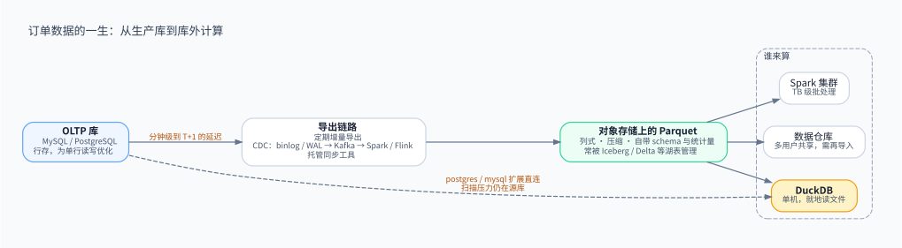
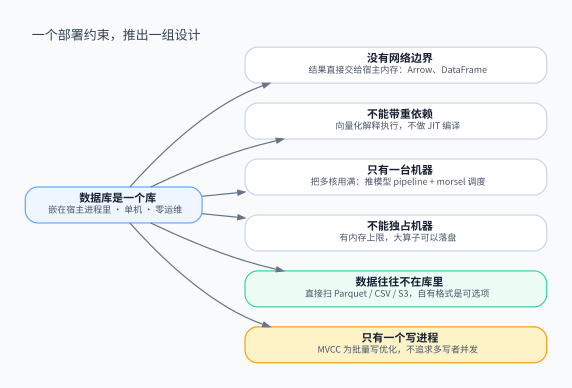
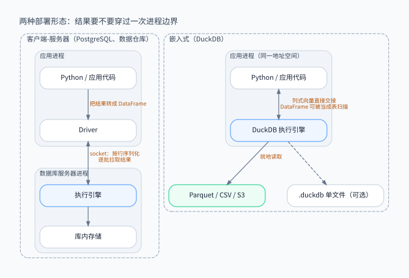
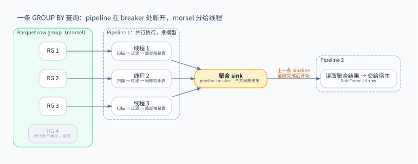

> DuckDB 是一个嵌入式的分析型数据库：它没有服务器进程，以一个库的形式链接进 Python、R、Java 或任意宿主程序里，在宿主的地址空间里跑列式、向量化、多核并行的 SQL。它用到的执行技术，几乎都在 MonetDB、VectorWise、HyPer 里出现过；真正的新意在部署形态，**「数据库是一个库」这个约束**，它的大部分设计都可以从这个约束推出来。这篇沿着这条线，看每个设计在回应约束的哪一面，又付出了什么代价。

<!-- more -->

## 1. 先追问场景：这份 Parquet 是从哪来的

> 订单数据最初几乎都在 OLTP 数据库里。它会变成 Parquet，是因为分析不该压在生产库上，而 Parquet 是把数据交给「库外」计算的通用格式。DuckDB 的位置，要放在这条链路里才看得清。

全文用同一个问题：今年每个区域的订单收入是多少。

订单最初写在 MySQL 或 PostgreSQL 里。这类库是行存，有 B+ 树索引，为「按主键读写一行」优化。直接在生产库上回答这个问题，有两处不合适：

- **行存要读整行**：只用到 `region`、`amount`、`order_date` 三列，扫描时却要把每行的 30 列都读一遍。
- **和生产流量抢资源**：一条扫全表的长查询会占用 IO、缓冲池和 CPU。挪到只读副本上能保护主库，但副本仍然是行存，扫描的低效还在。

所以多数团队会有一条导出链路，把数据搬出 OLTP 库：

- **定期导出**：每天按 `updated_at` 拉一次增量，写成按日期分区的文件；
- **CDC**：Debezium 这类工具读取 binlog 或 WAL，经 Kafka 由 Spark / Flink 写进 Iceberg、Delta 这样的湖表，湖表的数据文件本身就是 Parquet；
- **托管同步工具**：Airbyte、Fivetran 等，目的地通常是数据仓库或对象存储。

落地的格式之所以几乎都是 Parquet，是因为它恰好满足库外计算的需求：列式存放，可以只读需要的列；压缩率高；文件里自带 schema 和每个 row group 的统计量；任何引擎都能读；放在对象存储上很便宜。它已经是数据离开数据库之后的通用交换格式。



- 上面那条实线是常态路径：数据经导出链路离开 OLTP 库，以 Parquet 的形式落在对象存储上，再由不同的引擎消费。
- 下面那条虚线是不经导出、直接查源库的捷径，后面单独讨论。

这条链路本身是有成本的：数据有分钟级到 T+1 的延迟，多存了一份，源库的 schema 一变，下游就要跟着改。消除这段链路，正是 Lakebase 一类架构想做的事（见[什么是 Lakebase](/database/lakebase/what-is-lakebase/)）。但在今天的大多数系统里，它已经存在，而且这些 Parquet 文件往往不止服务一个消费方。

于是真正要回答的问题变成：**数据已经以列式文件的形式躺在库外了，谁来算？** 下面把场景具体化：一台 16 GB 内存、8 核的笔记本，把这批订单文件同步到了本地（也可以直接读对象存储，第 7 节再说）。这些文件压缩后 20 GB（在源库里占的空间通常要大好几倍），按月切成几十个 Parquet 文件，每行 30 列，覆盖三年。

```python
import duckdb

duckdb.sql("""
    SELECT region, sum(amount) AS revenue
    FROM 'orders/*.parquet'
    WHERE order_date >= DATE '2026-01-01'
    GROUP BY region
    ORDER BY revenue DESC
""").df()
```

在 DuckDB 出现之前，算这批文件的几种选择各有各的别扭：

- **pandas**：数据要先整个读进内存。20 GB 的 Parquet 解压后放不进 16 GB 内存，进程直接被 OOM 杀掉；即便放得下，大部分操作也只用一个核。
- **Spark**：能算，但为 20 GB 数据起一个集群（或者在本地跑 JVM 版的单机模式），启动和调优的成本都和数据量不成比例。
- **数据仓库**：要建表、再导入一次（又多一份），查询结果还要通过 socket 一批批拉回 Python。对一次性的探索分析来说，准备工作比查询本身还重。

DuckDB 的做法是：不起服务、不导入数据，就地扫这些 Parquet 文件，只读需要的列和行，用满 8 个核，内存不够时把中间结果写到磁盘，最后把结果直接交给 DataFrame。

图里那条虚线也值得说一句。如果没有导出链路，DuckDB 可以通过 postgres / mysql 扩展直接连源库，把表当成本地表来查，投影和过滤也能下推到源库。但这只是把计算挪到了 DuckDB，扫描仍然发生在源库的行存上，压力也落在源库上。它适合偶尔的一次性分析或小表关联，不适合作为常态的分析路径。反过来，如果数据只有几 GB、查询也不频繁，直接在只读副本上跑 SQL 可能就够了，不需要引入任何新工具。DuckDB 的价值，随着数据量、查询频率，以及「数据已经在库外」这三件事一起增加。

下面逐层拆开 DuckDB 是怎么做到的。

## 2. 新意在部署形态，不在执行技术

> 把 DuckDB 的组件一个个拿出来，都能找到前人的影子。新的是把它们装进一个「库」里，而这个约束反过来决定了每个组件怎么选型。

DuckDB 在 2018 年由 CWI（荷兰国家数学与计算机科学研究所）数据库组的 Mark Raasveldt 和 Hannes Mühleisen 发起，这个组也是列存数据库 MonetDB 的发源地。它的核心组件大多有清晰的来路：

| 技术 | 来源 | 在 DuckDB 里的形态 |
|---|---|---|
| 列式存储 | MonetDB 一脉的列存研究 | 表按列存放，每列分段压缩 |
| 向量化执行 | MonetDB/X100，即后来的 VectorWise | 算子一次处理一批值（默认 2048 个） |
| morsel 驱动的并行 | HyPer | 以数据块为单位，把工作分给线程 |
| MVCC | HyPer 的 MVCC 设计 | 针对批量更新优化的多版本并发控制 |

所以要理解 DuckDB，重点不是哪一个组件，而是它要在什么约束下工作。SQLite 证明了「数据库是一个库」在事务场景下可行；DuckDB 的定位常被概括为「分析场景的 SQLite」。这个约束有几面，每一面都对应一组设计选择：



- 左边是唯一的前提，右边六条是它的直接后果，后面各节依次展开。
- 绿色那条（数据往往不在库里）是嵌入式分析独有的处境；黄色那条（只有一个写进程）是这个约束最主要的代价。

## 3. 没有网络边界：删掉的是整个传输层

> 对分析查询来说，把结果从服务器搬到客户端，常常比算出结果还慢。嵌入进程直接删掉了这一段。

客户端-服务器架构里，结果集要穿过一次进程边界：服务器把列式的中间结果转成按行的协议格式，序列化，经 socket 发出；driver 反序列化，再由应用转换成 DataFrame。对 OLTP 这无所谓，结果只有几行。但分析和数据科学的工作负载经常要把百万行级别的结果拉回来做后续处理，这时传输就成了瓶颈。

DuckDB 的两位作者在此之前专门测过这件事：他们比较了多个主流数据库的客户端协议，发现把大结果集导出到客户端的耗时可以比查询执行本身高出一个数量级，瓶颈在按行序列化的协议设计上（Raasveldt & Mühleisen，*Don't Hold My Data Hostage: A Case for Client Protocol Redesign*，VLDB 2017）。DuckDB 可以看成这项研究的一个极端答案：既然边界这么贵，就不要边界。



- 左边，结果要经过「列 → 行协议 → 列」两次转换和一次 socket；右边，引擎和应用共享地址空间，列式的结果直接交给宿主。
- 右边的箭头是双向的：DuckDB 也能反过来直接扫描宿主内存里的 DataFrame 或 Arrow 表。

第二点同样重要。在 Python 里，SQL 可以直接引用一个 DataFrame 变量名，DuckDB 通过「替换扫描」（replacement scan）把它当成一张表来读，对 Arrow 格式的数据不需要复制。于是 SQL 和 DataFrame 代码可以在同一段脚本里交替使用，中间结果不用落盘或导入。

**代价**：没有边界，也就没有隔离。查询和应用共用一个进程，引擎崩溃会带走宿主，查询的内存和 CPU 也直接和宿主抢。服务器型数据库天然具备的用户、权限、连接管理，在这里都不存在，需要的话得由宿主程序自己实现。

## 4. 不能带重依赖：选择向量化，而不是编译

> 向量化和 JIT 编译都能消除逐行解释的开销。DuckDB 选向量化，是因为一个库承受不起编译器依赖和编译延迟。

传统的 Volcano 模型里，每个算子提供一个 `next()`，每次返回一行。每处理一行，都要经过好几层虚函数调用和类型分派，CPU 的大部分时间花在调度上，而不是真正的计算上。分析查询动辄扫几亿行，这个开销会被放大到不可接受。

消除它有两条路：

| 模型 | 每次处理 | 解释开销 | 代表系统 | 代价 |
|---|---|---|---|---|
| 逐行（Volcano） | 一行 | 每行一次调度 | 传统行存数据库 | CPU 主要花在调度上 |
| 向量化 | 一批值（DuckDB 默认 2048 个） | 每批一次调度 | VectorWise、DuckDB | 中间结果要物化成向量 |
| JIT 编译 | 整条 pipeline 编译成一个紧凑循环 | 几乎没有 | HyPer、Umbra | 需要编译器基础设施，每个查询有编译延迟 |

两条路的性能在很多基准上互有胜负。DuckDB 选向量化，主要是出于部署约束：JIT 通常需要 LLVM 这样的大型依赖，一个要被装进各种语言运行时、甚至编进 WebAssembly 跑在浏览器里的库，很难背上它；短查询的编译时间也可能比执行时间还长；解释执行的代码在调试和移植上也简单得多。

向量大小取 2048 也是一种折中：一批足够大，可以把调度开销摊薄，并让编译器生成 SIMD 友好的循环；又足够小，一条 pipeline 里几列的向量能一起留在 CPU 缓存里，不至于每一步都打到内存。

## 5. 只有一台机器：推模型的 pipeline 与 morsel

> 单机上能扩展的只有核数。DuckDB 把查询切成 pipeline，把数据切成 morsel，让所有核都有活干，并且由调度器而不是算子来控制执行。

物理计划会在 **pipeline breaker** 处被切开：凡是必须先吃完全部输入才能产出结果的算子，比如哈希聚合、哈希 join 的建表端、排序，都会成为一条 pipeline 的终点（sink）。开头的查询可以切成两段：扫描、过滤、局部聚合是一条；读取聚合结果、交给宿主是另一条。排序本身也是 breaker，为了简洁，图里省略了它。



- 同一条 pipeline 内部是并行的：数据源被切成一个个 morsel（对 Parquet 来说通常以 row group 为单位），空闲的线程领一个 morsel，把它一路推到 sink。
- 每个线程先在自己的局部哈希表里聚合，最后在 sink 合并，线程之间在热路径上不需要加锁。
- 灰掉的 RG 4 是根据 row group 统计量直接跳过的块，见第 7 节。

morsel 驱动的思路来自 HyPer（Leis 等，*Morsel-Driven Parallelism*，SIGMOD 2014）：并行度不在规划时写死，而是运行时由线程动态领取任务决定，慢的 morsel 不会拖住其他线程。

DuckDB 另一个值得说的决定是从拉模型改成推模型，这个改动发生在 2021 年前后的版本里。拉模型下，上层算子调用下层的 `next()`，控制流分散在每个算子内部；推模型下，由 pipeline 执行器从数据源取出一个向量，依次推过各个算子，直到 sink。控制流集中之后，调度器可以在任意两个向量之间暂停或切换一条 pipeline，把每条 pipeline 当成可调度的任务交给线程池，单个算子也不必各自实现并行逻辑。

## 6. 不能独占机器：内存是有上限的

> 服务器数据库可以假设整台机器都是自己的，嵌入式引擎不行。DuckDB 的答案是给内存设上限，让大算子在超限时落盘，而不是让宿主进程被杀掉。

开头的笔记本上，同时还开着浏览器、IDE 和 Jupyter。嵌入式引擎不能假设内存都归自己，也不能假设数据一定放得下。

DuckDB 默认把内存上限设为物理内存的 80%（可以用 `memory_limit` 调整）。哈希聚合、哈希 join、排序、窗口函数这些会积累大量状态的算子，在接近上限时会把部分数据写到临时目录，之后再分批读回处理。对用户而言，区别在于失败的方式：pandas 在数据放不下时整个进程被杀，DuckDB 则是变慢但能完成。

本例的聚合只按区域分组，哈希表很小，用不到落盘。但如果改成按订单 ID 去重或做大表 join，这个能力就决定了查询能不能在笔记本上跑完。

**代价**：落盘意味着磁盘 IO，性能会明显下降；内存上限设得太低，本来可以在内存里完成的查询也会去写盘。这是用可预期的变慢，换取不崩溃。

## 7. 数据往往不在库里：自有格式是可选项

> 第 1 节那条导出链路已经把数据变成了文件。DuckDB 把「就地查询」当成一等公民，自己的存储格式只是其中一个选项。

服务器数据库默认数据在库里。但正如第 1 节所说，分析用的数据通常已经被导出链路、Spark 作业或日志系统写成了文件，而且同一批文件还要服务其他消费方。再要求导入一次，就意味着在导出链路之后再多存一份，还要多管一段同步。

DuckDB 直接扫描 Parquet、CSV、JSON，可以读本地文件，也可以通过扩展读 S3、HTTP 上的文件。开头那条查询能在笔记本上跑完，主要靠两种下推：

- **投影下推**：Parquet 是列式格式，30 列里只需要读 `region`、`amount`、`order_date` 三列。
- **过滤下推**：每个 row group 带有每列的 min/max 统计量。如果文件大致按日期组织，前两年的 row group 根据 `order_date` 的最大值就能整块跳过，连解压都不需要。

粗略估算，真正要读的数据不到 1 GB，具体取决于各列的宽度和数据是否按日期有序。这比任何执行优化都更关键：最快的数据就是不用读的数据。

需要反复查询或者更新数据时，也可以把数据导入 DuckDB 自己的格式。它是一个单文件（外加一个 WAL）：表被切成每组 122,880 行的 row group，每列按段选择轻量压缩，比如常量、RLE、位压缩、字典，字符串用 FSST，浮点数用 ALP；每段同样带 min/max 统计量（zone map），用于跳过数据块。

| 方式 | 适合 | 代价 |
|---|---|---|
| 直接查 Parquet / CSV | 一次性探索；数据由别的系统产出和维护 | 每次都要读文件元数据；CSV 每次都要重新解析；远程文件受网络带宽限制 |
| 导入 `.duckdb` 文件 | 反复查询；需要更新、删除 | 多一份数据，需要自己管理和上游的同步 |
| 纯内存数据库 | 管道里的临时计算、中间步骤 | 进程退出即丢失 |

## 8. 只有一个写进程：为批量写设计的事务

> DuckDB 支持完整的 ACID 事务，但它的 MVCC 是为「少量的大批写入」设计的，而不是「大量的小事务」。多进程同时写，是这个部署形态明确放弃的东西。

DuckDB 的事务是可串行化的 ACID 事务，MVCC 的设计借鉴了 HyPer（Neumann 等，*Fast Serializable Multi-Version Concurrency Control*，SIGMOD 2015）：更新在原地进行，旧版本保存在 undo buffer 里，供仍在运行的旧事务读取。分析场景的写入通常是大批量的追加或更新，比如每天导入一批数据、整列重算，这个设计让批量写的开销很低，也不需要后台清理旧版本。

并发的边界要分两层看：

- **同一个进程内**：多个连接、多个线程可以并发读写。冲突采用乐观处理，两个事务修改同一行时，后提交的那个会报冲突错误，由应用重试。
- **跨进程**：同一个数据库文件，要么只被一个进程以读写方式打开，要么被多个进程以只读方式打开。

这正是第 2 节图里那条黄色的代价。DuckDB 不适合作为多个服务同时写入的共享数据库，也不适合高并发的小事务负载：列存加批量优化的 MVCC，对「每秒上万次单行更新」并不友好。需要这种能力的场景，应该交给 PostgreSQL 这类 OLTP 数据库，再把数据导出或同步给 DuckDB 分析。

## 9. 边界，以及它被扩展的方向

> DuckDB 的适用范围就是「单机、单写进程、分析负载」。它的生态正在围绕这几条边界向外扩展，而不是去改变引擎本身的定位。

| 场景 | 是否合适 | 原因 |
|---|---|---|
| 笔记本或单台服务器上的探索分析 | 合适 | 零部署，就地查文件，用满多核 |
| 数据管道里的转换步骤 | 合适 | 可以替代 pandas 脚本或小规模的 Spark 作业 |
| 应用内嵌的分析功能、边缘设备、浏览器 | 合适 | 库形态，有 WebAssembly 版本 |
| 高并发小事务 | 不合适 | 列存加批量 MVCC，单写进程 |
| 多用户共享的分析服务 | 需要在外面包一层服务 | 没有内建的服务器、用户和权限体系 |
| 超出单机处理能力的数据 | 不合适 | 没有分布式执行 |

围绕这些边界，生态里出现了几种扩展：

- **扩展机制**：文件格式、远程存储、空间数据、全文检索等能力以扩展的形式按需加载，核心库保持轻量，这也是「不能带重依赖」的另一种体现。
- **MotherDuck**：一个托管的云端 DuckDB 服务，支持混合执行，一条查询的一部分在本地 DuckDB 上跑，另一部分在云端跑，用来补上多用户共享和数据集中存放的需求。
- **DuckLake**：DuckDB 团队在 2025 年提出的湖表格式。数据仍然是对象存储上的 Parquet 文件，但表的元数据（快照、文件列表、统计量）放在一个普通的 SQL 数据库里，而不是像 Iceberg 那样以文件的形式放在对象存储上。它回应的是「数据不在库里」之后的下一个问题：多个引擎怎样一致地读写同一批文件。

## 10. 小结

DuckDB 没有发明新的执行技术，它做的是一次约束驱动的组合：

- **嵌入进程**，于是删掉了客户端协议，结果和 DataFrame 之间可以直接交接；
- **不带重依赖**，于是选择向量化解释执行，而不是 JIT 编译；
- **只有一台机器**，于是用推模型的 pipeline 和 morsel 调度把多核用满；
- **不能独占机器**，于是给内存设上限，让大算子可以落盘；
- **数据不在库里**，于是把就地扫描 Parquet / CSV 当成一等公民；
- **只有一个写进程**，于是 MVCC 为批量写优化，并明确放弃多进程并发写。

这些后果合在一起，划定了它擅长的范围：单机上、数据量从几 GB 到几百 GB、以读为主的分析。在这个范围里，它把「起一个数据库」的成本降到了「import 一个库」。

## 参考资料

- Raasveldt & Mühleisen，*DuckDB: an Embeddable Analytical Database*，SIGMOD 2019（demo）。
- Raasveldt & Mühleisen，*Don't Hold My Data Hostage: A Case for Client Protocol Redesign*，VLDB 2017。
- Boncz、Zukowski、Nes，*MonetDB/X100: Hyper-Pipelining Query Execution*，CIDR 2005。
- Leis 等，*Morsel-Driven Parallelism: A NUMA-Aware Query Evaluation Framework for the Many-Core Age*，SIGMOD 2014。
- Neumann、Mühlbauer、Kemper，*Fast Serializable Multi-Version Concurrency Control for Main-Memory Database Systems*，SIGMOD 2015。
- [DuckDB 官方文档](https://duckdb.org/docs/)：内存限制、并发模型、存储格式与扩展的当前行为。
