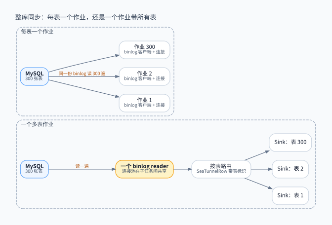

> Apache SeaTunnel 是一个数据同步工具：把数据从一处搬到另一处，既支持批量全量，也支持基于 CDC 的持续增量，内置一百多个 source / sink connector。它的演进经历了两个判断。第一个是 **connector 不该绑死在某个计算引擎上**，于是有了一套独立的 connector API，可以跑在 Spark、Flink 上。第二个是 **同步不是计算**：同步负载「表很多、变换很少」，通用流计算引擎在这种负载下的成本结构不对，于是又有了自己的引擎 Zeta。这篇沿着这两个判断，看 SeaTunnel 在每一层解决什么、放弃什么。

<!-- more -->

## 1. 先追问：为什么需要一个专门的同步工具

> 同步看起来只是「读出来、写进去」，但真正的复杂度藏在全量与增量的衔接、删除、源库压力、表的数量和 schema 变更里。只有一两张表、能接受 T+1 时，脚本就够了。

[DuckDB 那篇](/database/duckdb/embedded-olap/)把订单数据的来路追到了一条导出链路：数据从 MySQL 搬到对象存储上的 Parquet，再交给库外的引擎计算。这篇讨论的就是这条链路本身。

把场景具体化：订单库是 MySQL，按用户分了 256 张 `order_xx` 表，再加上退款、物流等几十张业务表，共约 300 张。需求是把它们同步到两个地方：Iceberg 湖表给离线分析，Doris 给分钟级延迟的实时报表。历史数据要全量搬一次，之后持续同步增量。

最朴素的做法是 cron 加 SQL：每天按 `updated_at` 拉一次增量，写成文件。只有一两张表、能接受 T+1 时，这就是最合理的方案。但需求一变复杂，问题就会依次冒出来：

- **删除丢失**：按 `updated_at` 拉增量看不到被删掉的行。
- **`updated_at` 不可靠**：有的写入路径忘了更新它，有的批量修数据的脚本直接绕过了它。
- **全量和增量的衔接**：全量导出要跑几个小时，这期间的变更既不能丢，也不能重复。
- **源库压力**：对大表做全量 `SELECT`，或者 300 个任务各自去读 binlog，都会压到生产库。
- **schema 变更**：上游加了一列，下游的表和同步任务都要跟着改。
- **目标端语义**：写入失败重试时会不会写重，取决于目标端支不支持事务或按主键幂等写入。

为了解决前几个问题，业界的主流答案是 CDC：不去查表，而是读数据库的变更日志（MySQL 的 binlog、PostgreSQL 的 WAL），删除和每一次更新都能看到。可选的工具大致有这几类：

| 方案 | 形态 | 适合 | 代价 |
|---|---|---|---|
| cron + SQL / dump | 脚本 | 少量表，T+1 | 看不到删除，全量对源库压力大 |
| Debezium + Kafka + Kafka Connect | 以 Kafka 为中心 | 已经有 Kafka 的团队，多个下游订阅同一份变更 | 为同步专门维护一套 Kafka 偏重 |
| Flink CDC | Flink 作业 | 同步途中还要做复杂的流计算 | 每个作业都是一个完整的 Flink 作业 |
| DataX | 单进程批量工具 | 离线全量搬迁 | 不支持 CDC，单机 |
| Airbyte、Fivetran | 托管的 ELT 服务 | SaaS 数据源，不想自己运维 | 按量付费，自建场景不灵活 |
| SeaTunnel | 自建、批流一体的同步工具 | 表多、源和目标种类多、不想强依赖 Kafka | 下文逐层展开 |

SeaTunnel 的前身是 Waterdrop，最早是一个基于 Spark 的数据处理工具，2021 年进入 Apache 孵化器并改名，2023 年毕业成为顶级项目。它今天的形态，是从「Spark 上的处理工具」一步步收窄成「同步工具」的结果。

## 2. 第一个判断：connector 不该绑死在引擎上

> N 个源乘 M 个目标，再乘 K 个引擎，connector 的数量会爆炸。SeaTunnel 定义了一套自己的 connector API，让每个 connector 只写一次。

早期的 SeaTunnel 直接用 Spark 和 Flink 各自的接口写 connector。结果是同一个 MySQL source 要为 Spark 写一份、为 Flink 写一份，Flink 升级一个大版本接口一变，又要再改一轮。connector 是同步工具最主要的资产，这种绑定让它的维护成本随引擎数量成倍增加。

于是 SeaTunnel 在 2.2 前后引入了一套与引擎无关的 connector API（社区称为 Connector V2），在 API 和引擎之间加了一层翻译：


- 所有 connector 只依赖 SeaTunnel 自己的 API：数据在内部统一表示为 `SeaTunnelRow`，表结构用 `CatalogTable` 描述。
- 翻译层把 SeaTunnel 的 source / sink 包装成 Flink 和 Spark 各自的接口；后来出现的 Zeta 则直接原生运行这套 API。

用户看到的是一份声明式的配置，用 HOCON 写，分为 `env`、`source`、`transform`、`sink` 四段：

```hocon
env {
  job.mode = "STREAMING"
  parallelism = 4
  checkpoint.interval = 10000
}

source {
  MySQL-CDC {
    base-url = "jdbc:mysql://orders-db:3306/orders"
    username = "sync"
    password = "******"
    table-names = ["orders.order_00", "orders.order_01", "orders.refund"]
    startup.mode = "initial"   # 先做全量快照，再接 binlog
  }
}

sink {
  Iceberg {
    # catalog、命名空间、写入模式等参数以所用版本的文档为准
  }
}
```

**代价**：翻译层意味着取的是各引擎能力的交集。引擎特有的能力（比如 Flink 的某些状态后端特性、Spark 的某些优化）很难透传给 connector；出了问题，排查时也要多看一层。这也是后来做自有引擎的动因之一。

## 3. Source 的抽象：批和流是同一件事

> 批量读和流式读都被抽象成「先切分、再读取」：有界的数据源切完就结束，无界的数据源一直有新的 split。同一个 connector 因此可以同时支持两种模式。

SeaTunnel 的 source API 和 Flink 新的 source 接口（FLIP-27）思路一致，把读取拆成两个角色：

- **SourceSplitEnumerator**：运行在协调端，负责把数据切成一个个 split 并分配出去。对 JDBC 表，split 是一段主键范围；对 Kafka，split 是一个分区；对文件，split 是一个文件或文件的一段。
- **SourceReader**：运行在各个并行任务里，领取 split 并真正去读。

批和流的区别只在于 split 是否有尽头：全量同步时，枚举器把表切完、所有 split 读完，作业就结束（`job.mode = "BATCH"`）；CDC 同步时，全量部分切完之后，还有一个永远读不完的 binlog split（`job.mode = "STREAMING"`）。

这种切分也是可恢复性的基础：检查点里记录每个 split 读到了哪里，失败后从检查点恢复，已完成的 split 不用重读。

## 4. CDC：全量和增量怎么无缝接上

> 难点不在读 binlog，而在把「几个小时的全量快照」和「快照期间一直在变的 binlog」拼成一份既不丢、也不重的数据。SeaTunnel 用前后两个 binlog 位点夹住每一次分块读取，做到不锁表。

最直接的做法是先锁表、记下 binlog 位点、导出全量、解锁，再从记下的位点开始读 binlog。对一张几亿行的订单表，锁表几个小时在生产上是不可接受的。

SeaTunnel 的 CDC connector 采用的是无锁的增量快照算法，思路来自 Netflix 的 DBLog，Flink CDC 2.x 也用了同一套做法。表按主键切成 chunk，每个 chunk 独立完成快照：


- 在 ① 和 ③ 之间，`SELECT` 读到的是一个「不确定是哪个时刻」的结果：有的行可能已经被并发事务改过，有的还没有。
- ④ 用这段时间窗口里的 binlog 事件修正它：只挑主键落在本 chunk 范围内的事件，按主键覆盖到结果上。修正之后，结果等价于位点 H 那一刻这个 chunk 的状态。

所有 chunk 都完成之后，进入增量阶段：从各 chunk 高水位里最小的那个位点开始读 binlog。对某一条变更，如果它所在的 chunk 的高水位比它更晚，说明它已经包含在快照里了，跳过；否则照常输出。这样全量和增量之间就既没有空隙，也没有重叠。

chunk 之间互不依赖，所以全量阶段可以多个任务并行读不同的 chunk；每个 chunk 完成后都会记进检查点，失败后只需重做没完成的 chunk。

**代价和前提**：

- 表需要主键或唯一键来切 chunk；没有的话，就退化为更弱的一致性保证或者无法并行。
- binlog 必须是 ROW 格式，而且保留时间要覆盖整个全量阶段，否则增量阶段开始时，需要的 binlog 已经被清理掉了。
- 全量阶段对源库仍有读压力，只是不再锁表。chunk 的大小和并行度是在「快照多快」和「源库多难受」之间做取舍。

## 5. Sink 的抽象：精确一次要靠目标端配合

> source 能重放，sink 能两阶段提交，合起来才是精确一次。目标端不支持事务时，退而求其次的办法是按主键幂等写入。

失败恢复时，source 会从检查点记录的位置重放，所以检查点之后已经写出去的数据会再写一遍。要做到精确一次，sink 端必须能把「写」和「提交」分开。SeaTunnel 的 sink API 为此分成几个角色：

- **SinkWriter**：在各个并行任务里写数据。检查点到来时，调用 `prepareCommit()`，返回一份「待提交」的信息，比如事务 ID 或临时文件列表；
- **SinkCommitter**：检查点成功后，提交这些信息；
- **SinkAggregatedCommitter**：需要全局提交的 sink 使用它，把所有并行任务的待提交信息汇总起来，做一次统一的提交，比如往 Iceberg 表里提交一个快照。

这其实就是两阶段提交：检查点成功之前，写出的数据对外不可见；检查点成功之后，才一并生效。能做到什么程度，取决于目标端：

| 目标端类型 | 例子 | 能得到的语义 |
|---|---|---|
| 支持事务 | 支持 XA 的数据库 | 精确一次 |
| 先写文件再提交 | Iceberg、文件系统 | 精确一次，提交即生效 |
| 支持主键 upsert | Doris 的 Unique Key 表、StarRocks 的主键表 | 至少一次，但重放的写入按主键覆盖，结果等价于精确一次 |
| 只能追加 | 普通的追加写入 | 至少一次，可能有重复 |

对 CDC 同步来说，第三类最常见：目标表有主键，重放的变更只是把同一行再写一遍，最终结果不变。这比真正的分布式事务便宜得多，前提是目标表必须有和源表一致的主键。

## 6. 第二个判断：同步不是计算

> 流计算引擎为「少量的流、复杂的计算」而设计，同步负载却是「大量的表、几乎没有计算」。负载形状不同，资源、连接和故障域的成本结构也不同。SeaTunnel 为此做了自己的引擎 Zeta。

在 Flink 上做整库同步，常见的做法是每张表一个作业，或者把所有表塞进一个巨大的 DAG。对 300 张表，两种做法都有问题：



- **每表一个作业**：每个作业都有自己的 binlog 客户端，同一份 binlog 被拉了 300 遍，源库要维持 300 条复制连接，网络和解析的开销也跟着翻 300 倍。每个作业还各自占着 slot 和内存，大部分时间却在空转。
- **一个大作业**：作业级的故障恢复意味着其中一张表的 sink 出错（比如某个目标表的 schema 不兼容），整个作业的 300 张表都要一起从检查点重启。

Zeta（最初叫 SeaTunnel Engine，2.3.0 起作为默认引擎）是针对这种「宽而浅」的负载设计的：

- **多表作业，binlog 只读一遍**：一个 source 可以同时读多张表，`SeaTunnelRow` 里带着表的标识，下游按表路由到对应的 sink。
- **连接共享**：同一个作业里的子任务可以共享到同一个数据库的连接，不再每个任务各开一组，减轻源库的连接压力。
- **pipeline 级的故障恢复**：一个作业里互不相连的部分被划分成独立的 pipeline，各自做检查点。一个 pipeline 失败，只重启它自己，不牵连其他表。
- **轻依赖的集群**：集群成员管理和分布式状态基于内嵌的 Hazelcast，不强依赖 ZooKeeper 或外部的资源管理器；检查点可以存在本地磁盘、HDFS 或对象存储上。

Transform 的能力也相应地被刻意限制在轻量的范围：字段改名、类型转换、过滤、简单的 SQL 表达式。复杂的 join 和窗口聚合，不是同步工具该承担的，应该交给下游的 Flink、Spark 或者数仓。

值得一提的是，Flink CDC 在 3.x 版本里也引入了 YAML 定义的整库同步 pipeline，支持多表和 schema 变更，走向了相似的方向。这从侧面说明，「同步」作为一种单独的负载形态，确实需要不同于通用流计算的抽象。

**代价**：多了一个引擎要运维和理解。Zeta 的社区规模、生产验证的广度、监控和调优的生态都还不如 Flink 和 Spark。已经有成熟 Flink 平台的团队，继续让 SeaTunnel 跑在 Flink 上也是合理的选择，代价是放弃上面这些同步专用的优化。

## 7. schema 变更：最容易被低估的部分

> 长期运行的同步任务一定会遇到上游改表。能否把 DDL 自动传到下游，取决于 source 能否解析它、sink 能否执行它，两端的类型系统也要能对上。

CDC 读到的不只是数据变更，也有 DDL 事件。上游执行了 `ALTER TABLE order_00 ADD COLUMN coupon_id BIGINT`，有三种处理方式：

- **作业失败**：最保守，需要人工处理后再恢复；
- **忽略**：下游的表结构不变，新列的数据被丢掉；
- **自动演进**：把 DDL 翻译成目标端的语法并执行，然后继续同步。

SeaTunnel 在部分 source 和 sink 的组合上支持自动演进，覆盖的范围在不同版本之间变化较大。加列通常容易处理，改类型、改名、删列就难得多：源端一个 `VARCHAR(20)` 改成 `VARCHAR(50)`，在某些目标端只是改一下元数据，在另一些目标端则意味着重建表。即使工具支持，也需要给每种 DDL 定一个明确的策略，而不是全部放给自动处理。

## 8. 边界：什么时候不用它

> SeaTunnel 适合「自建、表多、源和目标种类多」的同步。数据量小、已有 Kafka 体系，或者同步途中要做重计算时，都有更合适的选择。

| 情况 | 更合适的选择 | 原因 |
|---|---|---|
| 一两张表，T+1 可接受 | cron + SQL | 引入任何系统都比脚本重 |
| 已经有 Kafka，多个下游要订阅同一份变更 | Debezium + Kafka Connect | 变更进 Kafka 一次，各下游独立消费 |
| 同步途中要做 join、窗口聚合 | Flink（含 Flink CDC） | 那已经是计算，不只是同步 |
| 数据源是 SaaS 应用（CRM、广告平台） | Airbyte、Fivetran | 它们的 connector 覆盖的是这一类源 |
| 自建、整库或多库同步、多种目标、批和 CDC 用同一个工具 | SeaTunnel | 本文讨论的场景 |

## 9. 小结

SeaTunnel 的设计可以概括为两次收窄：

- **从引擎上的插件，收窄成引擎无关的 connector 体系**：connector 只依赖 SeaTunnel 自己的 API，批和流统一为「切分加读取」，一个 connector 可以跑在多个引擎上，代价是只能用到引擎能力的交集。
- **从通用计算，收窄成同步专用的引擎**：同步负载宽而浅，于是 Zeta 让一个作业读一遍 binlog 服务所有表、共享连接、按 pipeline 隔离故障，代价是多了一个引擎要运维。

而同步真正难的那几件事，答案分布在不同的层：全量与增量的衔接靠水位夹住的增量快照，精确一次靠可重放的 source 加两阶段提交或幂等写入的 sink，schema 变更则必须由 source、sink 和人共同约定策略。

## 参考资料

- Andreakis & Papapanagiotou，*DBLog: A Watermark Based Change-Data-Capture Framework*，2020：无锁增量快照的思路来源。
- Flink FLIP-27，*Refactor Source Interface*：split 枚举器与 reader 分离的 source 设计。
- [Apache SeaTunnel 文档](https://seatunnel.apache.org/docs/)：Connector V2、Zeta 引擎、各 connector 的参数与 schema 演进支持范围，以所用版本为准。
