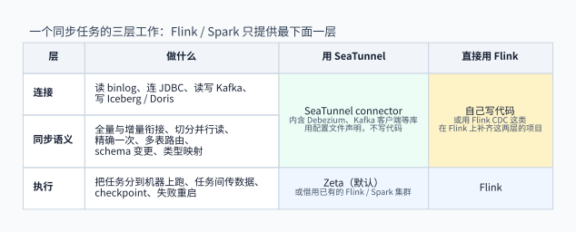
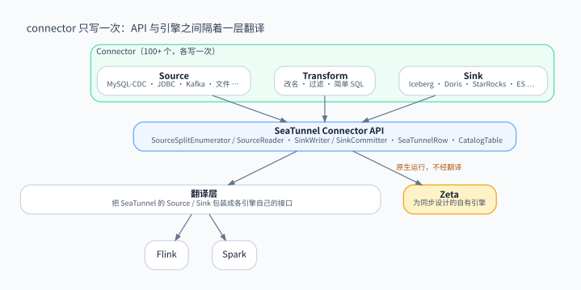

> Apache SeaTunnel 是一个数据同步工具：把数据从一个系统搬到另一个系统，既能批量搬全量，也能基于 CDC 持续同步增量。读者最自然的疑问是：Flink、Spark 已经能分布式地处理数据流了，为什么还要它？答案是，一个同步任务有三层工作：连接各个系统、保证同步语义、分布式执行。**Flink 和 Spark 只提供最下面的执行层**，SeaTunnel 提供的是上面两层。执行层因此是可以换的：SeaTunnel 可以借用 Flink / Spark，但它最后发现，为同步专门写一个引擎更合适。

<!-- more -->

## 1. 要解决的问题

> 同步看起来只是「读出来、写进去」，难的是全量与增量的衔接、删除、源库压力、表的数量和 schema 变更。只有一两张表、能接受 T+1 时，脚本就够了。

[DuckDB 那篇](/database/duckdb/embedded-olap/)把订单数据的来路追到了一条导出链路：数据从 MySQL 搬到对象存储上，再交给库外的引擎计算。这篇讨论的就是这条链路本身。

场景是这样的：订单库是 MySQL，按用户分成 256 张 `order_xx` 表，加上退款、物流等业务表，共约 300 张。要把它们同步到两个地方：Iceberg 湖表给离线分析，Doris 给分钟级延迟的实时报表。历史数据先全量搬一次，之后持续同步增量。

最朴素的做法是 cron 加 SQL：每天按 `updated_at` 拉一次增量。只有一两张表、能接受 T+1 时，这就是最合理的方案。需求一变复杂，问题就会依次冒出来：

- **删除丢失**：按 `updated_at` 拉增量，看不到被删掉的行。
- **`updated_at` 不可靠**：有的写入路径忘了更新它，批量修数据的脚本也常常绕过它。
- **全量和增量的衔接**：全量导出要跑几个小时，这期间的变更既不能丢，也不能重复。
- **源库压力**：对大表做全量 `SELECT`，或者 300 个任务各自去读 binlog，都会压到生产库。
- **schema 变更**：上游加了一列，下游的表和同步任务都要跟着改。
- **目标端语义**：写入失败重试时会不会写重，取决于目标端是否支持事务或按主键幂等写入。

前两个问题的标准答案是 CDC：不去查表，而是读数据库的变更日志（MySQL 的 binlog、PostgreSQL 的 WAL），删除和每一次更新都能看到。剩下几个问题，才是同步工具真正要解决的。

## 2. 为什么不直接用 Flink / Spark

> 一个同步任务分三层：连接、同步语义、执行。Flink / Spark 只提供执行层，上面两层要么自己写，要么用一个专门补齐它们的项目。SeaTunnel 就是这样的项目。

把上一节的问题按性质分类，可以分成三层：



- **连接层**：和具体系统打交道。读 MySQL binlog、连 JDBC、读写 Kafka、写 Iceberg 和 Doris，每个系统都有自己的协议和客户端。
- **同步语义层**：保证数据搬得对。全量和增量怎样衔接，大表怎样切分并行读，失败重试怎样不丢不重，多张表怎样在一个任务里路由，上游改了表结构怎么办，两端的类型怎么对应。第 1 节列出的问题，几乎都落在这一层。
- **执行层**：把任务分到多台机器上跑，在任务之间传数据，定期做 checkpoint，失败后重启。

Flink 和 Spark 是通用的计算引擎，它们做的是执行层，而且做得很好。但它们不知道 binlog 位点怎么和全量快照对齐，也不知道 Doris 的写入怎样才能不重复。直接用 Flink 做这件事，上面两层就得自己写代码。

在 Flink 上补齐这两层的现成项目是 Flink CDC。所以**真正可比的是 SeaTunnel 和 Flink CDC，而不是 SeaTunnel 和 Flink**。两者都提供连接层和同步语义层，区别在执行层：Flink CDC 绑定 Flink；SeaTunnel 默认用自己的引擎 Zeta，也可以借用已有的 Flink 或 Spark 集群。

图里还有一个容易混淆的点：Kafka。SeaTunnel 有 Kafka 的 source 和 sink connector，里面包含 Kafka 的客户端库，可以从 topic 读、往 topic 写，但它不包含也不依赖 Kafka 集群。作业两端都不是 Kafka 时，比如 `MySQL-CDC → Iceberg`，全程不需要 Kafka。Kafka 的价值在于做一条持久化的变更总线，让多个下游各自消费同一份变更，那是另一种架构选择（第 8 节）。

## 3. 执行层为什么能换：connector 只写一次

> SeaTunnel 定义了一套与引擎无关的 connector API，上面两层只依赖这套 API，再由一层翻译适配到不同的引擎上。这是执行层可以替换的前提。

SeaTunnel 的前身是 Waterdrop，最早是一个跑在 Spark 上的数据处理工具，后来也支持了 Flink。那时 connector 直接用 Spark 和 Flink 各自的接口写：同一个 MySQL source 要为 Spark 写一份、为 Flink 写一份，Flink 升级一个大版本、接口一变，又要再改一轮。connector 是同步工具最主要的资产，这种绑定让维护成本随引擎数量成倍增加。项目在 2021 年进入 Apache 孵化器并改名 SeaTunnel，2023 年毕业成为顶级项目。

转折是 2.2 前后引入的一套与引擎无关的 connector API，社区称为 Connector V2：



- 所有 connector 只依赖 SeaTunnel 自己的 API：数据在内部统一表示为 `SeaTunnelRow`，表结构用 `CatalogTable` 描述。
- 翻译层把 SeaTunnel 的 source / sink 包装成 Flink 和 Spark 各自的接口；Zeta 则直接原生运行这套 API。

API 本身的设计让批和流变成了同一件事。source 拆成两个角色：

- **SourceSplitEnumerator** 在协调端把数据切成一个个 split 并分配出去。对 JDBC 表，split 是一段主键范围；对 Kafka，是一个分区；对文件，是一个文件或文件的一段。
- **SourceReader** 在各个并行任务里领取 split 并真正去读。

批和流的区别只在 split 有没有尽头：全量同步时，表切完、所有 split 读完，作业就结束；CDC 同步时，全量部分切完之后，还有一个永远读不完的 binlog split。检查点里记录着每个 split 读到了哪里，失败后已经完成的 split 不用重读。

用户不写代码，而是写一份 HOCON 配置，分为 `env`、`source`、`transform`、`sink` 四段：

```hocon
env {
  job.mode = "STREAMING"
  parallelism = 4
  checkpoint.interval = 10000
}

source {
  MySQL-CDC {
    base-url = "jdbc:mysql://orders-db:3306/orders"
    username = "sync"
    password = "******"
    table-names = ["orders.order_00", "orders.order_01", "orders.refund"]
    startup.mode = "initial"   # 先做全量快照，再接 binlog
  }
}

sink {
  Iceberg {
    # catalog、命名空间、写入模式等参数以所用版本的文档为准
  }
}
```

这份配置不关心跑在哪个引擎上。**代价**是翻译层只能取各个引擎能力的交集，引擎特有的能力很难透传给 connector；出了问题，排查时也要多看一层。

## 4. 同步语义之一：全量和增量怎么接上

> 难点不在读 binlog，而在把「几个小时的全量快照」和「快照期间一直在变的 binlog」拼成一份既不丢、也不重的数据。SeaTunnel 用前后两个 binlog 位点夹住每一次分块读取，做到不锁表。

最直接的做法是先锁表、记下 binlog 位点、导出全量、解锁，再从记下的位点开始读 binlog。对一张几亿行的订单表，锁几个小时在生产上不可接受。

SeaTunnel 的 CDC connector 用的是无锁的增量快照算法，思路来自 Netflix 的 DBLog，Flink CDC 2.x 也用了同一套做法。表按主键切成 chunk，每个 chunk 独立完成快照：


- 在 ① 和 ③ 之间，`SELECT` 读到的是一个「不确定是哪个时刻」的结果：有的行可能已经被并发事务改过，有的还没有。
- ④ 用这段时间里的 binlog 事件修正它：只挑主键落在本 chunk 范围内的事件，按主键覆盖到结果上。修正后的结果，等价于位点 H 那一刻这个 chunk 的状态。

所有 chunk 完成之后进入增量阶段，从各 chunk 高水位里最小的那个位点开始读 binlog。对一条变更，如果它所在 chunk 的高水位比它更晚，说明它已经包含在快照里了，跳过；否则照常输出。这样全量和增量之间既没有空隙，也没有重叠。chunk 之间互不依赖，可以并行读；每完成一个 chunk 就记进检查点，失败后只重做没完成的部分。

**前提和代价**：

- 表需要主键或唯一键来切 chunk，否则就只能接受更弱的一致性保证，或者无法并行。
- binlog 必须是 ROW 格式，而且保留时间要覆盖整个全量阶段。
- 全量阶段对源库仍有读压力，只是不再锁表。chunk 大小和并行度，是在「快照多快」和「源库多难受」之间取舍。

## 5. 同步语义之二：精确一次要靠目标端配合

> source 能重放，sink 能两阶段提交，合起来才是精确一次。目标端不支持事务时，退而求其次是按主键幂等写入。

失败恢复时，source 会从检查点记录的位置重放，检查点之后已经写出去的数据会再写一遍。要做到精确一次，sink 必须把「写」和「提交」分开。SeaTunnel 的 sink API 为此分成几个角色：

- **SinkWriter** 在各个并行任务里写数据。检查点到来时调用 `prepareCommit()`，交出一份「待提交」的信息，比如事务 ID 或临时文件列表。
- **SinkCommitter** 在检查点成功之后提交这些信息。
- **SinkAggregatedCommitter** 用于需要全局提交的 sink，把所有并行任务的待提交信息汇总后统一提交一次，比如往 Iceberg 表里提交一个快照。

这就是两阶段提交：检查点成功之前，写出的数据对外不可见；成功之后才一并生效。能做到什么程度，取决于目标端：

| 目标端类型 | 例子 | 能得到的语义 |
|---|---|---|
| 支持事务 | 支持 XA 的数据库 | 精确一次 |
| 先写文件再提交 | Iceberg、文件系统 | 精确一次，提交即生效 |
| 支持主键 upsert | Doris 的 Unique Key 表、StarRocks 的主键表 | 至少一次，但重放按主键覆盖，结果等价于精确一次 |
| 只能追加 | 普通的追加写入 | 至少一次，可能有重复 |

CDC 同步里第三类最常见：目标表有主键，重放的变更只是把同一行再写一遍，结果不变。这比分布式事务便宜得多，前提是目标表和源表的主键一致。

## 6. 为什么最后还是自己写了引擎：同步不是计算

> 通用流计算引擎为「少量的流、复杂的计算」设计，同步负载却是「大量的表、几乎没有计算」。负载形状不同，资源、连接和故障域的成本也不同。所以 SeaTunnel 能借用 Flink，但默认用自己的 Zeta。

执行层可以换，不代表换哪个都一样。在 Flink 上同步 300 张表，常见的做法要么是每张表一个作业，要么是把所有表塞进一个大作业，两种都有问题：


- **每表一个作业**：每个作业都有自己的 binlog 客户端，同一份 binlog 被拉了 300 遍，源库要维持 300 条复制连接。每个作业还各自占着资源，大部分时间却在空转。
- **一个大作业**：作业级的故障恢复意味着，只要一张表的 sink 出错（比如目标表 schema 不兼容），300 张表都要一起从检查点重启。

Zeta（最初叫 SeaTunnel Engine，从 2.3.0 起作为默认引擎）是为这种「宽而浅」的负载设计的：

- **多表作业，binlog 只读一遍**：一个 source 同时读多张表，`SeaTunnelRow` 带着表的标识，下游按表路由到对应的 sink。
- **连接共享**：同一作业的子任务共享到同一个数据库的连接，减轻源库的连接压力。
- **pipeline 级的故障恢复**：作业里互不相连的部分划分成独立的 pipeline，各自做检查点。一个 pipeline 失败只重启它自己。
- **轻依赖**：集群协调用内嵌的 Hazelcast，不需要 ZooKeeper 或外部资源管理器；检查点可以存在本地磁盘、HDFS 或对象存储上。

transform 也被刻意限制在轻量范围：字段改名、类型转换、过滤、简单的 SQL 表达式。复杂的 join 和窗口聚合，交给下游的 Flink、Spark 或数仓。

Flink CDC 在 3.x 里也引入了 YAML 定义的整库同步 pipeline，支持多表和 schema 变更，走向了相似的方向。这从侧面说明，同步确实是一种需要单独抽象的负载。

到这里，可以回答「执行层选哪个」：

| 跑法 | 什么时候选 | 代价 |
|---|---|---|
| SeaTunnel + Zeta | 默认选择；只是为了同步，不想维护一套 Flink | 多一个引擎要运维，社区和生态都小于 Flink |
| SeaTunnel + 已有的 Flink / Spark | 公司已经有 Flink 或 Spark 平台，希望资源调度和监控统一 | 用不到 Zeta 的多表、连接共享和 pipeline 级恢复，还多一层翻译 |
| 直接用 Flink（Flink CDC + Flink SQL） | 同步途中还要做 join、窗口聚合这类真正的计算 | 同步能力取决于 Flink CDC 的覆盖范围，整库同步要面对上面的成本问题 |

## 7. schema 变更：最容易被低估的部分

> 长期运行的同步任务一定会遇到上游改表。DDL 能不能自动传到下游，取决于 source 能否解析、sink 能否执行，两端的类型也要能对上。

CDC 读到的不只是数据变更，也有 DDL。上游执行了 `ALTER TABLE order_00 ADD COLUMN coupon_id BIGINT`，有三种处理方式：

- **作业失败**：最保守，人工处理后再恢复；
- **忽略**：下游表结构不变，新列的数据被丢掉；
- **自动演进**：把 DDL 翻译成目标端的语法执行，然后继续同步。

SeaTunnel 在部分 source 和 sink 的组合上支持自动演进，覆盖范围在不同版本之间变化较大。加列通常容易，改类型、改名、删列就难得多：源端 `VARCHAR(20)` 改成 `VARCHAR(50)`，在有的目标端只是改元数据，在有的目标端意味着重建表。即使工具支持，也应该给每种 DDL 定一个明确的策略，而不是全部交给自动处理。

## 8. 怎么选

> SeaTunnel 适合「自建、表多、源和目标种类多、只是搬数据」的场景。数据量小、需要变更总线，或者同步途中要做重计算时，都有更合适的选择。

| 情况 | 更合适的选择 | 原因 |
|---|---|---|
| 一两张表，T+1 可接受 | cron + SQL | 引入任何系统都比脚本重 |
| 同一份变更要给很多下游（搜索、缓存、数仓）各自消费 | Debezium + Kafka Connect | 变更进 Kafka 一次，各下游独立消费、独立回放 |
| 同步途中要做 join、窗口聚合 | Flink（含 Flink CDC） | 那已经是计算，不只是同步 |
| 数据源是 SaaS 应用（CRM、广告平台） | Airbyte、Fivetran | 它们的 connector 覆盖的是这一类源 |
| 自建环境，整库或多库同步到多种目标，批量和 CDC 想用同一个工具 | SeaTunnel | 本文讨论的场景 |

这几种也可以组合。比如用 SeaTunnel 把变更写进 Kafka，各下游再从 Kafka 消费；或者别的系统已经把变更写进了 Kafka，SeaTunnel 只负责从 Kafka 写进 Doris。

## 9. 小结

- **Flink / Spark 只解决执行层。** 同步真正难的是连接层和同步语义层：全量与增量的衔接、精确一次、多表、schema 变更。SeaTunnel 提供的是这两层，所以应该拿它和 Flink CDC 比，而不是和 Flink 比。
- **执行层之所以能换**，是因为 connector 只依赖 SeaTunnel 自己的 API，再经翻译层适配到 Flink、Spark 上，代价是只能用到引擎能力的交集。
- **之所以默认不借用 Flink**，是因为同步负载宽而浅：Zeta 让一个作业读一遍 binlog 服务所有表、共享连接、按 pipeline 隔离故障，代价是多了一个引擎要运维。

## 参考资料

- Andreakis & Papapanagiotou，*DBLog: A Watermark Based Change-Data-Capture Framework*，2020：无锁增量快照的思路来源。
- Flink FLIP-27，*Refactor Source Interface*：split 枚举器与 reader 分离的 source 设计。
- [Apache SeaTunnel 文档](https://seatunnel.apache.org/docs/)：Connector V2、Zeta 引擎、各 connector 的参数与 schema 演进支持范围，以所用版本为准。
