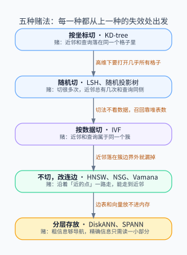
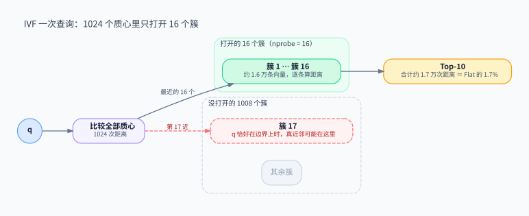
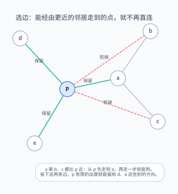
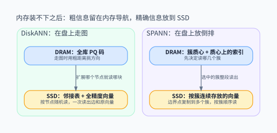

> 向量索引的名字很多，思想只有几种。每一种索引都是对「近邻会出现在哪里」的一个赌注：KD-tree 赌近邻和查询落在同一个格子里，LSH 赌随机切很多次总能切对几次，IVF 赌近邻在同一个簇里，图索引赌沿着近的点一路走能走到近邻，DiskANN / SPANN 赌粗信息就够导航。这篇沿着「每个赌注在哪里输掉、下一个赌注怎么补上」这条线，把主流索引串成一条演进链，细节只保留理解思想所必需的部分。

<!-- more -->

---

本文是向量检索系列的第一篇：

1. **索引在赌近邻在哪里**（本文）：怎样少算距离，还能找到近邻。
2. [量化在保住什么](/database/vector/quantization-landscape/)：怎样让每一次距离计算更便宜。

## 1. 一次查询到底贵在哪

> ANN 的基本交易是：放弃「一定找到最近的那几个」，换取「大概率找到，但只看很少一部分数据」。

全文用同一个场景：**100 万条 768 维的 FP32 向量，约 3 GB，每次查询要 Top-10，目标 recall@10 ≥ 0.95**（返回的 10 条里平均至少 9.5 条是真正的前 10 近邻）。

不建索引时，每次查询都要算 100 万次距离，约 7.7 亿次乘加。计算本身还不是最贵的，更贵的是带宽：每一次查询都要把 3 GB 数据从内存里完整搬一遍。后面所有结构，都可以用同一把尺子衡量：**每次查询要碰多少条向量**。

这件事之所以难，是因为高维空间不配合。对均匀随机的高维数据，最近点和最远点的距离会越来越接近，「近」这个概念本身就在消失；任何索引在这种数据上都退化成扫描。索引之所以还能工作，是因为真实的 embedding 并不均匀：它们挤在一个内在维度低得多的结构上。**所有索引都在赌这一点，区别只在于用什么方式去利用这个低维结构。**

- 从上往下，每一种结构都是为了补上一种的失效而出现的；箭头上标的就是上一种输掉的地方。
- 前三种都在「切空间」，第四种不再切，第五种处理的是数据放不进内存这个工程现实。

## 2. 第一种赌法：按坐标切

> KD-tree 赌近邻和查询落在同一个格子里。在低维成立，在高维几乎必输。

KD-tree 每一层挑一个维度，按中位数把点分成两半，递归下去。查询先走到自己所在的叶子，再回溯检查那些「可能藏着更近点」的相邻格子。

在二三维，这个方法很有效：格子是紧凑的，回溯很少。到了 768 维，问题出在两处：

- **切到的维度太少。** 100 万个点的平衡树大约 20 层，也就是说，整棵树只用到了 768 个维度里的二十来个。剩下的维度对划分毫无贡献。
- **查询球会穿过几乎所有切面。** 高维下，以查询为中心、半径等于近邻距离的球，会和大量切分超平面相交，回溯要打开的叶子迅速逼近全部。

经验上，KD-tree 在维度超过二十左右之后就不如直接扫描。这次失败留下的教训是：**沿坐标轴切，在高维浪费了绝大部分维度**。

## 3. 第二种赌法：随机切

> 不追求切得准，而是用随机性换一个概率保证：切很多次，近邻总有几次和查询在同一侧。

### 3.1 LSH：把「近」变成「碰撞概率高」

Locality-Sensitive Hashing 的思想是设计一族哈希函数，让相近的点更容易被映射到同一个桶。最直观的例子是随机超平面：随机取一个方向 $r$，用 $\mathrm{sign}(r \cdot x)$ 当一位哈希。两个向量落在同一侧的概率恰好是

$$
P[\,h(x) = h(y)\,] = 1 - \frac{\theta(x, y)}{\pi}
$$

其中 $\theta$ 是两者的夹角。夹角越小，碰撞概率越高。这和 KD-tree 的区别在于，随机方向会同时用到所有维度，而不是一次只看一维。

一位哈希太粗，于是要做两层组合：把若干位拼成一个桶号，让桶足够「挑剔」，不相关的点很少混进来；再建很多张这样的表，只要查询和近邻在任意一张表里撞上就算找到，用来把召回拉回来。

### 3.2 代价：切法不看数据

LSH 的吸引力是它有理论保证：召回可以写成概率表达式，插入也只是往桶里追加。但两层组合的代价很直接：召回要求越高，需要的表越多，内存和每次查询要探测的桶数一起膨胀。

更根本的问题是**切法和数据无关**。随机超平面不知道数据挤在哪里，在空旷的区域和稠密的区域切得一样密。真实 embedding 的低维结构没有被利用起来。在实践中，同等内存下 LSH 的召回–延迟曲线通常打不过调好的 IVF 或图索引；它今天更多出现在去重、特殊距离度量这些场景。

Annoy 一类的随机投影树森林是同一思想的树形版本：每个节点用随机超平面切一刀，建多棵树，查询时在每棵树里各走到一个叶子，合并候选。它部署轻量，索引可以直接 mmap，适合静态的中等规模数据；但动态更新不便，高召回区通常不如图索引。

这次失败留下的教训是：**既然数据有结构，切分就应该跟着数据走**。

## 4. 第三种赌法：按数据切

> IVF 用聚类让格子跟着数据分布走，赌近邻和查询属于同一个簇。它输在簇边界，却是最容易与其他技术组合的结构。

### 4.1 让数据决定格子

IVF（Inverted File）先在数据上跑 k-means，得到 $K$ 个质心，每条向量写进离它最近的那个质心的列表。数据稠密的地方，簇自然就小；数据稀疏的地方，簇自然就大。这正是 LSH 缺少的东西。

查询分两步：先算查询到全部质心的距离，再只扫描最近的 `nprobe` 个簇。在本文的场景里取 $K = 1024$（大约是 $\sqrt{N}$），`nprobe = 16`：

- 1024 次质心距离，加上 16 个簇里约 1.6 万条向量，合计约 1.7 万次距离，是 Flat 的 1.7% 左右。
- 漏检集中在一个地方：查询落在簇的边界附近时，真正的近邻可能在第 17 个簇里，而那个簇没被打开。

### 4.2 边界问题与它的两种补法

簇边界是 IVF 唯一的、也是结构性的弱点：k-means 把空间切成互不重叠的格子，而「近」是连续的，总有一部分近邻和查询分属两边。补法只有两类：

- **查询时多打开几个簇**，即调大 `nprobe`。召回上去，延迟线性上涨。
- **写入时把边界点复制到多个簇**。召回上去，存储和写入成本上涨。

两种补法都是在用资源换回被切断的连续性。IVF 没有办法「看到」隔壁簇里有什么，这是它和图索引最本质的区别。

### 4.3 为什么 IVF 最好组合

IVF 的召回–延迟曲线通常不如图索引，但它在工程上有一个独特的优点：**每个簇是一段独立、连续的列表**。由此带来的结果是：

- **量化可以按簇做**：存每条向量和所在质心的残差，残差的分布更集中，更容易压缩。这就是 IVF-PQ 的由来（见[量化篇](/database/vector/quantization-landscape/)）。
- **分片可以按簇做**：簇天然是分布式切分的单位。
- **写入就是追加**：新向量找到最近的质心，追加到列表末尾。
- **放到磁盘上依然高效**：一个簇就是一段可以顺序读的数据，第 6 节的 SPANN 就建立在这一点上。

它要付的代价是质心来自建库时的数据快照。数据分布漂移之后，簇会变得不均衡，需要重新聚类。

这次失败留下的教训是：**只要还在切，就一定有边界**。下一种思路干脆不切了。

## 5. 第四种赌法：不切了，改成连边

> 图索引不划分空间，而是记录「谁和谁近」，查询沿着边贪心地走。它的全部设计都围绕一个问题：每个点留哪些边。

### 5.1 贪心路由

给每个点连上若干条指向近邻的边。查询从某个入口点出发，每一步都移动到当前点的邻居中离查询最近的那个，直到没有邻居更近为止。实际实现会维护一个宽度为 `ef`（或 `L`）的候选队列，而不是只盯着一个点，以减少卡在局部最优的概率。

这个思想和 IVF 完全不同：IVF 需要事先决定「哪些点算一组」，图索引只需要在每一步做局部判断。簇边界的问题不复存在，因为邻接关系本身就是连续的。

但贪心路由能否成功，完全取决于图的形状：边太少，会卡在局部最优；边太多，每一步要算的距离太多，内存也吃不消。于是所有图索引的核心问题都变成了同一个：**在有限的出度里，留哪些边**。

### 5.2 留哪些边：剪掉「绕一步就能到」的边

最朴素的做法是每个点连向最近的 $k$ 个点，也就是 kNN 图。它的问题是边会扎堆：一个点的 $k$ 个近邻往往挤在同一个方向上，另外几个方向反而没有出路，贪心走到这里就卡住了。

现代图索引普遍采用的剪枝规则，源自几何里的相对邻域图（RNG）：

- 候选按距离从近到远处理。对候选 $b$，如果已经保留的某个邻居 $a$ 离 $b$ 比 $p$ 离 $b$ 还近，就不再连 $p \to b$，因为从 $p$ 走到 $a$，再走一步就能到 $b$。
- 省下来的出度会留给别的方向上的点。结果是每个点的边在方向上分散开，贪心路由在每一步都有路可走。

HNSW 的启发式选边、NSG 的 MRNG、Vamana 的剪枝，都是这条规则的变体。它们的差别不在查询方式，而在构建时怎么近似这条规则、怎么保证连通。

### 5.3 长边从哪来：分层与放宽

剪枝之后的边都偏短，从远处的入口出发要走很多步。图索引需要一些长边来快速跨越空间，两种主流做法给出了不同的答案：

- **HNSW：分层。** 借用跳表的思路，每个点以指数衰减的概率出现在更高的层里。高层的点稀疏，彼此之间的边自然就长，负责粗定位；底层包含全部点，负责细找。查询从顶层贪心地下降，到底层再展开束搜索。
- **Vamana：放宽剪枝。** 只建一层，但剪枝时加一个系数 $\alpha > 1$：只有当 $a$ 离 $b$ 明显更近（近到 $\alpha$ 倍以上）时才剪掉 $p \to b$。这样会多保留一部分较长的边，用一层图实现跨越。单层结构对磁盘布局更友好，这也是它被 DiskANN 采用的原因。

NSG 则从另一个角度出发：固定一个靠近数据中心的入口，并在构建时补边，保证从入口出发能到达每一个点。三者是同一个思想下的不同取舍，而不是三套查询哲学。

### 5.4 代价：内存、随机访问与删除

图索引在内存内的召回–延迟曲线通常是最好的，这也是 HNSW 成为很多向量库默认选项的原因。它的代价同样来自「连边」这个思想本身：

- **向量必须常驻内存。** 边表本身不大：常见配置下底层每个点 32 个邻居，每个 4 字节，100 万个点约 128 MB。真正大的是向量，因为每走一步都要算邻居的距离。这也是图索引几乎总要和量化搭配的原因。
- **访问模式是随机的。** 每一步跳到哪里取决于上一步的结果，缓存命中率差，无法像扫描列表那样顺序读。
- **删除很麻烦。** 删掉一个点会切断经过它的路径。常见做法是先打墓碑标记，再定期修复或重建。

这次失败留下的教训是：**图的质量依赖所有向量都能被随时访问**。数据量到十亿级，这个前提就不成立了。

## 6. 第五种赌法：内存装不下之后

> 把「导航需要的粗信息」和「最终判定需要的精确信息」分开存放：前者留在内存，后者放到 SSD，只为少数候选读盘。

十亿条 768 维向量约 3 TB，放不进单机内存。DiskANN 和 SPANN 给出了两种代表性的做法，恰好对应内存里的图索引和 IVF：

- **DiskANN：在盘上走图。** 内存里只放全部向量的 PQ 码（每条几十字节），走图时用这些粗距离决定往哪个方向扩展；邻接表和全精度向量放在 SSD 上，按节点存在一起，扩展一个节点就读一个块，最后用全精度向量给候选重排。
- **SPANN：在盘上放倒排。** 内存里只放簇质心和质心上的索引，用来决定读哪几个簇；簇的内容按顺序存在 SSD 上，边界点复制到多个簇里。查询时整段读出选中的簇。

两者的取舍和内存里的图与 IVF 如出一辙：DiskANN 做的是**少量的随机读**，延迟取决于要走多少步；SPANN 做的是**大块的顺序读**，代价是边界复制带来的存储放大。哪种更合适，取决于 SSD 的随机读能力和数据规模。

GPU 上的图索引（例如 CAGRA）是同一个思想换了一种硬件假设：图仍然是图，但为了吞吐，度数固定、布局重排，用大批量并行的距离计算替代 CPU 上逐步的指针跳转。它适合批量、高 QPS 的查询；单条查询的延迟、主机与显存之间的拷贝、过滤，则要另算一笔账。

## 7. 过滤与更新：违反假设的两类需求

> 上面每一种结构都建立在「几何上近」这一个假设上。过滤和更新之所以难，是因为它们直接违反这个假设。

### 7.1 过滤：「近」不等于「满足条件」

「找最近的 10 条，且必须是某个租户、某个时间范围内的」，在线上几乎是默认需求。但过滤谓词和向量几何毫无关系，满足条件的点可能稀疏地散落在空间各处。

| 策略 | 做法 | 输在哪里 |
|---|---|---|
| 先过滤 | 先按条件缩小范围，再在子集上做 ANN | 子集上往往没有现成的索引 |
| 后过滤 | ANN 多取一些候选，再按条件筛 | 条件很严时，多取多少都不够 |
| 遍历中过滤 | 走图或扫簇时跳过不满足条件的点 | 图上满足条件的邻居被滤光时，路径会断 |
| 按条件拆索引 | 每个租户或标签一份独立索引 | 运维成本和碎片化 |

IVF 在这里比图索引从容：不满足条件的簇可以整段跳过，簇内过滤也不影响「打开哪些簇」的决定。图索引则必须专门设计，例如在建图时就把标签信息带进选边（Filtered-DiskANN），或在遍历时扩大邻居范围以绕过被滤掉的点（ACORN）。**没有一个开关能让过滤变得无损，它总是需要二次设计。**

### 7.2 更新：结构是按旧数据建的

- **IVF：** 插入就是追加，删除就是标记；但质心是按旧数据训出来的，分布漂移后要重新聚类。
- **图索引：** 插入相对自然，新点按同样的规则找邻居、剪枝；删除会切断路径，需要修复。
- **磁盘索引：** 更新要在盘上结构外加一层增量缓冲和后台合并，FreshDiskANN、SPFresh 处理的就是这个问题。

选型时，更新速率需要单独考虑。静态数据上的 recall 曲线，不能代表边写边查时的表现。

## 8. 小结：选型就是选一个赌注

把五种赌法放在一起，选型问题就变成了：**你的数据和负载，最符合哪一个假设**。

| 场景 | 最贴合的假设 | 自然的选择 |
|---|---|---|
| 数据量小，或必须精确 | 不需要赌 | Flat |
| 过滤多、要分片、要和量化流水线组合 | 近邻在同一个簇里 | IVF 系 |
| 内存充足，要低延迟、高召回，插入为主 | 沿着近的点能走到近邻 | HNSW 或其他内存图 |
| 单机内存放不下，可以接受 SSD 的尾延迟 | 粗信息够导航 | DiskANN、SPANN |
| 批量查询、GPU 已就位 | 同上，换成吞吐优先 | GPU 图索引 |
| 静态中小数据，要部署简单 | 随机切很多次能切对 | Annoy 等随机投影树 |

新出现的名字，大多可以挂回这条链上的某一层：

| 名字 | 改的是哪一层 | 一句话 |
|---|---|---|
| E2LSH、多探测 LSH | 随机切 | 换哈希族，或一张表里多探测几个相邻桶 |
| IMI | 按数据切 | 两个子空间各自聚类，用笛卡尔积得到极细的格子 |
| NSW | 连边 | HNSW 的前身，长短边混在一层 |
| NSG、NSSG | 连边：选边与连通 | 固定入口，补边保证可达 |
| SPTAG | 切 + 连边 | 用树找入口，再在图上搜索 |
| CAGRA | 分层存放：GPU | 固定度数、为并行重排布局 |
| FreshDiskANN、SPFresh | 分层存放：更新 | 盘上结构加增量层和后台合并 |
| ScaNN | 按数据切 + 打分 | 外壳是划分，竞争力主要来自量化（见下篇） |

遇到一个新索引，先问两个问题：**它赌近邻在哪里？赌输的时候，它靠什么补救？** 答出这两个问题，就能把它放回这张图里，而不必再背一份新的清单。

量化不在这条链上：它不决定看哪些候选，只决定看每个候选时有多便宜。这是[下一篇](/database/vector/quantization-landscape/)的主题。

## 参考资料

- Bentley, *Multidimensional Binary Search Trees Used for Associative Searching*, CACM 1975：KD-tree。
- Beyer 等, *When Is "Nearest Neighbor" Meaningful?*, ICDT 1999：高维下距离趋同。
- Indyk & Motwani, STOC 1998；Charikar, STOC 2002：LSH 与随机超平面哈希。
- Jégou, Douze, Schmid, *Product Quantization for Nearest Neighbor Search*, TPAMI 2011：IVF 与 IVF-ADC。
- Malkov & Yashunin, *Efficient and Robust Approximate Nearest Neighbor Search Using HNSW Graphs*, TPAMI 2018。
- Fu 等, *Fast Approximate Nearest Neighbor Search with the Navigating Spreading-out Graph*, VLDB 2019：NSG。
- Subramanya 等, *DiskANN*, NeurIPS 2019：Vamana 与盘上图索引。
- Chen 等, *SPANN*, NeurIPS 2021：盘上倒排与边界复制。
- Gollapudi 等, *Filtered-DiskANN*, WWW 2023；Patel 等, *ACORN*, SIGMOD 2024：带过滤的图索引。
