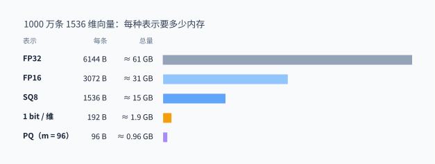
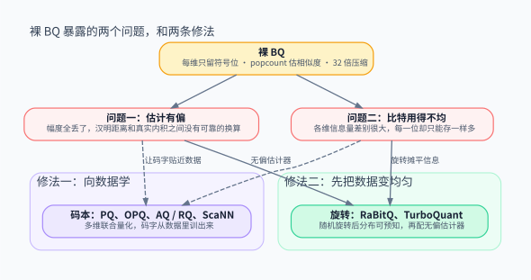
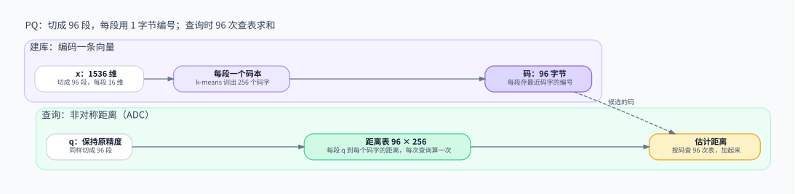
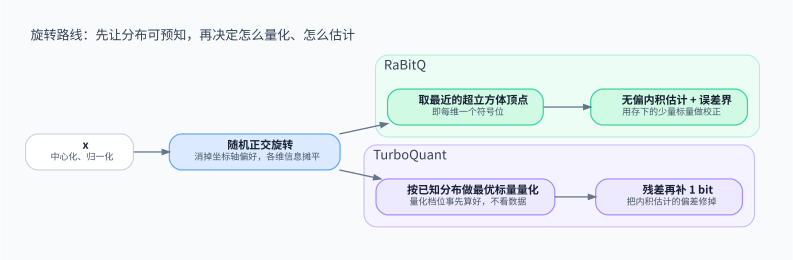

> 向量量化要保住的不是向量本身，而是**排序**：用更少的比特表示向量之后，任意一个查询算出来的 Top-K 仍然大体正确。沿着「每维少存几位」一路压下去，到 1 bit 的裸 BQ 会暴露两个问题：估计有偏，比特用得不均。此后的方法分成两条路：PQ 一系向数据学码本，RaBitQ / TurboQuant 一系先把数据旋转得均匀，再配一个无偏估计器。两条路比到最后，比的不是谁省了更多比特，而是谁能说清楚自己的估计错了多少。

<!-- more -->

---

本文是向量检索系列的第二篇：

1. [索引在赌近邻在哪里](/database/vector/ann-index-landscape/)：怎样少算距离，还能找到近邻。
2. **量化在保住什么**（本文）：怎样让每一次距离计算更便宜。

索引和量化是正交的两件事：索引决定看哪些候选，量化决定看每个候选时有多便宜。IVF、HNSW、DiskANN 都可以和本文的任意一种量化组合。

## 1. 量化要保住的是排序

> 量化的评判标准是 Top-K 还对不对，而不是向量还原得像不像。

全文用同一个场景：**1000 万条 1536 维向量**。

- FP32 要 61 GB，单机内存已经很吃力；压到 1 bit 每维，只要 1.9 GB；PQ 取 96 字节一条，不到 1 GB。
- 省下来的不只是内存。检索时每算一次距离，都要把向量从内存搬进 CPU；码越短，同样的带宽就能扫过越多候选，SIMD 一次也能处理越多维度。

量化和大模型的权重量化同属「低比特」，但目标不同。权重量化关心模型输出是否还准确；向量量化关心的是，**对一个事先未知的查询**，基于压缩表示估出来的距离，排序是否和真实距离一致。这带来两个具体要求：

- **估计要对任意查询都靠得住。** 查询不在建库时出现，量化不能只对某一批查询调得好。
- **最好能说清楚误差有多大。** 线上通常先用粗码筛出候选，再用原向量重排。知道估计会错多少，才能决定要重排多少条。

第二点是全文的伏笔，第 6 节会回到这里。

## 2. 少存几位：FP16 与 SQ

> 最直接的做法是让每一维独立地少存几位。简单、可靠，但压缩比有天花板。

最便宜的一步是把 FP32 换成 FP16 或 BF16：内存减半，距离计算仍然是浮点运算，对大多数 embedding 而言排序几乎不变。

再往下是标量量化（SQ）：每一维独立地做仿射映射，映射到 256 个档位上，用一个字节存储：

$$
\hat{x}_j = \mathrm{round}\!\left(\frac{x_j - z_j}{s_j}\right) \in \{0, 1, \ldots, 255\}
$$

其中 $z_j$、$s_j$ 是第 $j$ 维的偏移和步长，通常来自这一维的取值范围。SQ8 相对 FP32 压缩 4 倍，很多向量库把它当作「先省一档内存」的默认选项。

SQ 的思想是**每一维各管各的**，它的局限也来自这里：

- **压缩比有天花板。** 8 bit 是 4 倍；降到 4 bit 是 8 倍，但召回掉得很快。
- **维度之间的相关性被忽略了。** embedding 的各维并不独立，信息集中在少数方向上，而 SQ 给每一维分配同样多的比特。

LVQ 等方法在 SQ 上做了改进，例如按每条向量自适应地选择尺度，但思想仍是每维独立量化。

那么，沿着这条路一直压下去，每一维只留 1 bit 会怎样？

## 3. 推到极限：裸 BQ

> 每维只留一个符号位，压缩 32 倍、计算极快，但它把量化的两个根本问题同时暴露了出来。

二值量化（BQ）最朴素的形式，是每一维只保留符号：

$$
b_j = \mathbf{1}[\,x_j \ge 0\,]
$$

一条 1536 维向量变成 1536 bit，也就是 192 字节。两条向量的相似度用汉明距离估计：异或之后数 1 的个数，1536 bit 只需要 24 次 64 位的异或和 popcount。压缩 32 倍，计算也几乎是最快的。

但在真实 embedding 上，裸 BQ 的召回常常会骤降。原因有两个，它们决定了后面所有方法的走向。

**问题一：估计有偏。** [上一篇](/database/vector/ann-index-landscape/)讲 LSH 时提到过，随机超平面哈希满足

$$
P[\,h(x) = h(y)\,] = 1 - \frac{\theta(x, y)}{\pi}
$$

因此汉明距离可以无偏地估计夹角。裸 BQ 看起来像是同一件事，其实不是：它的「超平面」是坐标轴本身，而不是随机方向。这个概率关系只在超平面方向随机时才成立；坐标轴相对于数据并不随机，于是汉明距离和真实夹角之间没有可靠的换算。再加上幅度信息全部丢失，内积估计就更无从谈起。

**问题二：比特用得不均。** 如果数据没有中心化，很多维的符号几乎恒定，这些比特不携带任何信息。即使中心化之后，各维的方差也差别很大：少数几维承载了大部分信息，却和噪声维一样只分到 1 bit。

- **修法一：向数据学。** 不再逐维量化，而是多维联合量化，码字从数据里训出来，让比特花在数据真正分布的地方。这是 PQ 一系。
- **修法二：先把数据变均匀。** 不学数据，而是先做一次随机旋转，让信息均匀地摊到每一维，再配一个能证明无偏的估计器。这是 RaBitQ / TurboQuant 一系。

## 4. 修法一：向数据学码本

> PQ 的思想是多维联合量化，用「切成子空间」让码本小到能训练。它的变体都在回答同一组问题：怎么切、码本怎么构成、损失函数是什么。

### 4.1 为什么要切成子空间

理论上最好的量化，是在整个 1536 维空间里直接做 k-means，让码字完全贴合数据分布。问题是码本的规模：96 字节等于 768 bit，整空间量化需要 $2^{768}$ 个码字，这既无法训练，也无法存储。

Product Quantization（PQ）的做法是把向量切成 $m$ 段，每段单独训一个小码本：

- 1536 维切成 96 段，每段 16 维，每段用 k-means 训出 256 个码字。一条向量存成 96 个编号，每个编号 1 字节。
- 只需存 $96 \times 256$ 个子码字，组合起来却能表示 $256^{96}$ 种向量。笛卡尔积让码本在训练和存储上都变得可行。

查询时通常用非对称距离（ADC）：查询向量保持原精度，先算出它的每一段到该段所有码字的距离，得到一张 $96 \times 256$ 的表；之后每个候选的距离，都只是按它的 96 个编号查表再求和：

$$
\hat{d}(q, x)^2 = \sum_{u=1}^{m} \big\| q^{(u)} - c^{(u)}_{i_u(x)} \big\|^2
$$

其中 $c^{(u)}_{i_u(x)}$ 是 $x$ 在第 $u$ 段对应的码字。距离表每次查询只算一次，此后对每个候选都只有查表和加法。Faiss 的 FastScan 进一步把码和表重排进 SIMD 寄存器，让查表的吞吐接近纯计算的上限。

### 4.2 变体：三个旋钮

PQ 之后的大量工作，都可以看成在调同一组旋钮：

| 旋钮 | 代表 | 思想 |
|---|---|---|
| 怎么切 | OPQ | 切分之前先学一个正交旋转，让各段之间更独立、信息分得更均匀 |
| 码本怎么构成 | AQ、RQ | 不切分，而是用几组全维码字相加来表示向量，同样比特下失真更低，但编码更难 |
| 损失是什么 | ScaNN | 不最小化重建误差，而是按误差对内积排序的影响来加权 |

最后一行值得多说一句。ScaNN 观察到：对内积检索而言，沿着向量自身方向的误差，比垂直方向的误差对排序的伤害更大。于是它在训练码本时，对平行方向的误差施加更大的惩罚。这直接回到了第 1 节的标准：**量化要保住的是排序，不是重建**。

OPQ 也值得注意：它在切分前做的旋转，和第 5 节的随机旋转是同一个动作，只不过 OPQ 的旋转是学出来的。两条修法在这里有了交集。

### 4.3 代价：码本是数据的快照

向数据学的代价，就是对数据的依赖：

- **需要训练。** 码本要用有代表性的数据训出来，冷启动和多租户场景下不一定有这样的数据。
- **分布漂移后要重训。** 新数据仍然可以用旧码本编码，但误差会逐渐变大。
- **估计有偏，且没有误差界。** ADC 算的是到重建点的距离，而不是到原向量的距离；偏差的方向和大小因数据而异，对单个候选也给不出「最多错多少」的保证。

最后一点意味着，PQ 的重排数量只能凭经验设定：多留一些候选，用原向量重排，指望真正的近邻在里面。

## 5. 修法二：先把数据变均匀

> 不学数据，而是先做一次随机旋转，让分布变得可以预知；在可预知的分布上，就能设计出可证明无偏、带误差界的估计器。

### 5.1 为什么随机旋转有用

随机正交旋转不改变任何距离和内积，因此对检索结果没有损失。它改变的是信息在各维之间的分布：

- 旋转之前，信息可能集中在少数几维上，这正是裸 BQ 问题二的来源。
- 旋转之后，每一维都是原来所有维的随机混合，信息被均匀摊开。高维下还有测度集中现象：一个单位向量旋转后的每个坐标，都近似服从同一个已知的分布，方差约为 $1/D$。

**分布可以预知**这一点是关键。分布已知，量化误差就能被分析，估计器就能被设计成无偏的，误差界也能被证明。PQ 的码本要从数据里学；在这里，需要的信息在旋转之后已经由数学给出了。

随机旋转的另一个好处是**不依赖数据**：不需要训练，新数据随时可以写入，理论保证对任何数据都成立。

ITQ 是两条修法之间的过渡：它也先旋转再取符号位，但旋转矩阵是学出来的。

### 5.2 RaBitQ：同样是 1 bit，差在估计器

RaBitQ 的流程可以概括为四步：

1. 以数据中心（在 IVF 里是簇的质心）为原点，把向量归一化成单位向量 $o$。
2. 做一次随机正交旋转。
3. 把旋转后的向量映射到最近的超立方体顶点 $\{\pm 1/\sqrt{D}\}^D$。这其实就是取每一维的符号位，每维 1 bit。
4. 另存几个标量用来校正，其中最关键的是量化向量 $\bar{o}$ 和原向量的内积 $\langle \bar{o}, o \rangle$。

估计内积时用：

$$
\langle o, q \rangle \approx \frac{\langle \bar{o}, q \rangle}{\langle \bar{o}, o \rangle}
$$

这个估计是无偏的，而且误差以高概率不超过 $O(1/\sqrt{D})$ 量级。距离可以由内积和两个范数换算出来，所以同样适用于欧氏距离检索。

和裸 BQ 相比，RaBitQ 每维存的比特数一样多，区别在三件事上：先做随机旋转，修掉了问题二；多存几个校正标量；用一个能证明无偏的估计器，修掉了问题一。**同样是 1 bit，差别在估计器，而不在省了多少比特。** 它的多比特扩展沿用同一个思想，每维多存几位，用来换取更高的精度。

### 5.3 TurboQuant：用已知分布做最优标量量化

TurboQuant 走的是同一条路的另一种做法。它最初是为大模型 KV Cache 的在线压缩设计的：那里的数据实时产生，根本没有机会训练码本。

它利用的是旋转之后「每个坐标的分布已知、且彼此近似独立」这个性质：

- **分布已知，就可以事先算出最优的标量量化档位**（Lloyd–Max 量化器），对每一维直接套用。档位不依赖数据，算一次就能对所有数据通用。
- **按均方误差最优的量化，会让内积估计产生偏差**，因为它会系统性地把幅度往里收缩。TurboQuant 的做法是：少用 1 bit 做均方误差最优的量化，再对残差做一次 1 bit 的随机投影（QJL），把内积估计的偏差修掉。

和 RaBitQ 相比：RaBitQ 把量化后的向量看成超立方体上的一个顶点，从几何出发设计估计器；TurboQuant 把每个坐标看成一个分布已知的标量，从信号处理出发设计量化器。两者的共同前提，都是先用随机旋转换来一个可以分析的分布。

### 5.4 代价：不看数据，也就用不上数据的结构

- **旋转不会消除数据本身的结构。** 真实 embedding 往往集中在一个低维子空间上。随机旋转会把信息摊匀，但不会利用「数据只占了一部分空间」这一点；在极低比特下，针对数据训练的码本在某些数据集上仍可能更优。工程上通常还要配合按簇中心化等校准手段。
- **旋转本身有成本。** 稠密的随机正交矩阵乘一次是 $O(D^2)$；实际实现常用快速 Hadamard 变换之类的结构化旋转，降到 $O(D \log D)$。

## 6. 为什么估计器比比特数更重要

> 两条修法最终比的，不是谁省了更多比特，而是谁能说清楚自己的估计错了多少。

回到第 1 节埋下的伏笔：线上几乎总是先用粗码筛出候选，再用原向量重排。重排是有成本的：原向量要么在内存里占着空间，要么要从 SSD 上读。**重排多少条**，因此和比特数一样，是一个直接影响延迟的决定。

- **没有误差界时**，比如 PQ，只能凭经验多留一些候选，比如几百条，统一重排。留少了会漏掉近邻，留多了就是在浪费。
- **有误差界时**，比如 RaBitQ，可以对每个候选单独判断：如果它估计距离的下界，已经大于当前第 K 名的精确距离，它就不可能进入 Top-K，可以直接跳过。只有估计结果「拿不准」的候选才需要重排，重排数量随数据自适应。

| | 裸 BQ | PQ 系 | RaBitQ | TurboQuant |
|---|---|---|---|---|
| 码本看不看数据 | 不看 | 看，需要训练 | 不看，只需随机旋转 | 不看，档位事先算好 |
| 估计是否无偏 | 否 | 否 | 是 | 是（内积） |
| 是否有误差保证 | 无 | 无 | 有，逐候选可用 | 有，理论失真界 |
| 在线写入 | 容易 | 用旧码本，误差会漂移 | 容易 | 容易 |

## 7. 粗排加精排：生产中的默认形态

> 量化不需要单独给出最终答案。比特预算和重排预算是两个旋钮，需要一起调。

单一档位的量化，很少从粗筛一直扛到最终结果。常见的组合是：

| 组合 | 粗排 | 精排 |
|---|---|---|
| IVF-PQ + 重排 | 簇内用 PQ 查表估距 | 原向量，或 SQ8 / FP16 |
| HNSW + SQ / BQ | 走图时用低比特码打分 | 候选用 FP16 / FP32 重排 |
| DiskANN | 内存里的 PQ 码导航 | SSD 上的全精度向量重排 |
| IVF + RaBitQ | 1 bit 或多比特估距，配误差界 | 只重排拿不准的候选 |

这也解释了为什么论文里报告的「不重排时的召回」，和线上的实际表现不是同一个工作点。线上看的是两个旋钮组合起来之后的召回–延迟曲线：粗码越短，需要重排的候选越多；估计器越可靠，需要重排的候选越少。

## 8. 小结

- 量化的标准是保住排序，不是还原向量。
- 每维独立量化（FP16、SQ）简单可靠，但压缩比有天花板；推到 1 bit 的裸 BQ 暴露了两个根本问题：估计有偏，比特用得不均。
- 修法一是向数据学码本（PQ、OPQ、AQ / RQ、ScaNN）：贴合数据，但依赖训练，估计有偏、没有误差界。
- 修法二是先旋转、再量化（RaBitQ、TurboQuant）：不看数据，用可预知的分布换来无偏估计和误差界。
- 估计器的质量决定了重排预算，在线上它往往比比特数更重要。

新方法出现时，可以用三个问题把它挂回这张地图：**离散的单元是什么**（单维、子空间、还是整个向量）？**码本看不看数据**？**误差声明的是重建误差，还是内积和排序**？

| 名字 | 离散单元 | 码本看不看数据 | 一句话 |
|---|---|---|---|
| FP16 / BF16 | 单维 | 不看 | 精度截断，几乎无损的第一步 |
| SQ8 / SQ4、LVQ | 单维 | 轻量统计 | 每维独立的网格；LVQ 按向量自适应尺度 |
| BQ | 单维 1 bit | 不看 | 只留符号位 |
| ITQ | 单维 1 bit | 看（学旋转） | 先学旋转再取符号 |
| PQ、FastScan | 子空间 | 看 | 切段训码本；FastScan 是 SIMD 查表实现 |
| OPQ、LOPQ | 子空间 | 看 | 切分前先学旋转；LOPQ 按簇各学一个 |
| AQ、RQ、LSQ | 整个向量（码字相加） | 看 | 加性码本；LSQ 加速编码 |
| ScaNN | 子空间 | 看 | 损失按对内积排序的影响加权 |
| JPQ 等 | 子空间 | 看（与编码器联合训练） | 码本和 embedding 模型一起为检索优化 |
| RaBitQ 及多比特扩展 | 单维（旋转后） | 不看 | 超立方体顶点 + 无偏估计 + 误差界 |
| QJL | 随机投影 1 bit | 不看 | 无偏的 1 bit 内积估计 |
| TurboQuant | 单维（旋转后） | 不看 | 已知分布下的最优标量量化 + 残差 QJL |

## 参考资料

- Jégou, Douze, Schmid, *Product Quantization for Nearest Neighbor Search*, TPAMI 2011：PQ 与 ADC。
- André, Kermarrec, Le Scouarnec, VLDB 2015：PQ FastScan。
- Ge 等, *Optimized Product Quantization*, CVPR 2013：OPQ。
- Babenko & Lempitsky, *Additive Quantization*, CVPR 2014：AQ。
- Martinez 等, ECCV 2016 / 2018：LSQ、LSQ++。
- Guo 等, *Accelerating Large-Scale Inference with Anisotropic Vector Quantization*, ICML 2020：ScaNN。
- Gong & Lazebnik, *Iterative Quantization*, CVPR 2011：ITQ。
- Aguerrebere 等, VLDB 2023：LVQ。
- Gao & Long, *RaBitQ*, SIGMOD 2024；Gao 等, SIGMOD 2025：RaBitQ 的多比特扩展。
- Zandieh, Daliri, Han, *QJL*, AAAI 2025：1 bit 量化 JL 变换。
- Zandieh 等, *TurboQuant*, 2025：旋转后的最优标量量化与残差 QJL。
