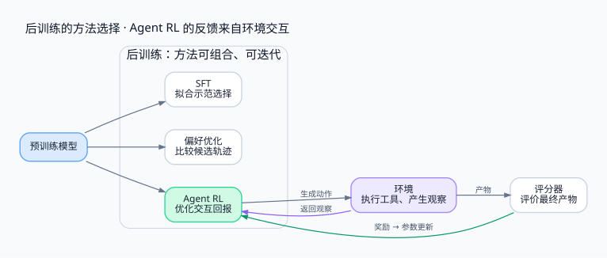

> 后训练是一类训练流程，RL 是其中一种可选的优化方法。Agent RL 的特别之处在于：它用策略自己在环境里交互得到的结果，去改变模型下一次做选择的概率。这一篇说清它要解决什么问题、和 SFT 怎么分工、训练的到底是什么，以及不可微的工具链为什么不妨碍求梯度。

<!-- more -->

**系列导航**

1. **为什么需要 Agent RL（本文）**
2. [从工具调用到可训练轨迹](/machine-learning/agent-rl/trajectory/)
3. [从 PPO 到 GRPO](/machine-learning/agent-rl/policy-optimization/)
4. [长轨迹上的信用分配](/machine-learning/agent-rl/credit-assignment/)
5. [GPU 训练与 CPU 环境如何协同](/machine-learning/agent-rl/training-system/)
6. [安全隔离与 Harness 解耦](/machine-learning/agent-rl/isolation/)
7. [跑通一个可验证的训练闭环](/machine-learning/agent-rl/minimal-experiment/)

DPO 不在主线编号里。想先弄清「偏好优化」和 Agent RL 的区别，可以选读[番外：DPO 到底补充了什么](/machine-learning/agent-rl/dpo-background/)。

---

## 1. 会回答、会调用工具，为什么仍然完不成任务

> 每一步都局部合理，不等于任务最终成功。两者之间隔着一段只有环境才能检验的距离。

给模型一个有 bug 的仓库。它能解释二分查找，也能生成格式正确的 `read_file` 和 `edit` 调用，却仍然可能交不出正确的补丁：找错文件、只修好一半边界、忽略失败日志，或者没有验证就宣布完成。

难点在于这些选择环环相扣。先读哪个文件，决定了后面能看到什么；一次修改，会改变下一次测试的结果；测试失败之后是继续定位、回退还是停止，又决定了最终产物。

Agent 把模型放进「观察、决策、执行、再观察」的循环。Agent RL 在此基础上追问：**能不能用这些决策造成的结果，改进模型以后做决策的方式？**

失败也不都出在模型身上。上下文里没有给对仓库、工具参数设计得过于复杂、测试本身随机失败，都会让一个很好的策略也做不好任务。工程上通常按三层排查：

| 层次 | 先确认什么 | 主要改进方式 |
|---|---|---|
| 信息与接口 | 所需的文件、工具、权限是否可用 | 检索、上下文组织、工具与提示词设计 |
| 基础行为 | 能否理解任务、合法调用工具、完成基本步骤 | 示范数据、SFT、换模型 |
| 连续决策 | 在自己的行动造成的新状态里，能否恢复并完成任务 | 搜索、推理预算，以及 Agent RL |

这几种手段可以组合使用。只有把瓶颈定位到第三层，也就是需要「学」出来的连续决策行为，一次 RL 训练才有明确的理由。

## 2. 后训练与 RL 不在同一个分类层次

> 后训练说的是「在训练流程的哪个阶段」，RL 说的是「用什么目标去优化」。两者是不同维度上的概念。

预训练通常是在大规模数据上学习预测下一个 token：给定前文，调整参数，让实际出现的下一个 token 概率更高。语言结构、知识关联和一部分推理能力都在这个阶段形成。

后训练是在预训练模型的基础上，为了指令遵循、偏好对齐、特定能力或行为约束而继续进行的训练。**后训练是流程上的阶段，强化学习是一类优化方法**，两者不在同一个分类层次上。

| 方法 | 数据或反馈 | 一次更新主要优化什么 |
|---|---|---|
| SFT（监督微调） | 示范回答或完整的行动轨迹 | 示范中目标 token 的条件似然 |
| DPO 等偏好优化 | 同一输入下的偏好对 | 相对偏好，同时受参考策略约束 |
| 基于奖励的 RL | 策略自己采样后得到的回报 | 策略的期望回报，通常附带约束 |

三者都可以出现在后训练里。常见的顺序是先让模型掌握基本接口，再用结果反馈改善任务表现；但这并不是唯一路线，数据生成、SFT 和 RL 也可以交替迭代。

另外三个常见的词，各自回答的是不同的问题：

- **RLHF**：反馈是否来自人。
- **RLVR**：奖励能否由程序验证，例如核对答案、编译、跑测试。
- **Agent RL**：策略是否在多步的环境交互中接受训练。

它们可以同时成立。一个代码 Agent 完全可以既用可验证的测试，又用人类偏好；这三个词描述的是三个独立维度，而不是先后更替的技术代际。

## 3. SFT 已经能教会工具使用，RL 又增加了什么

> SFT 学的是别人走过的路；在线 RL 让策略自己去走，再从自己走到的地方学习。

假设示范是这样一条轨迹：读文件、修改边界、运行测试、根据失败日志再修一次、提交。SFT 可以学会整条过程，包括失败之后的恢复。示范里可以有失败和重来，SFT 能学到的也远不止输出格式。

它的典型目标是：

$$
\mathcal{L}_{\text{SFT}}(\theta) = -\sum_t m_t \log \pi_\theta(y_t \mid x, y_{<t})
$$

其中 $m_t$ 标记哪些位置参与监督，例如只有助手生成的位置。这个目标的含义是：在这个上下文里，提高示范中那个选择的概率。筛选成功轨迹、调整数据配比和 token 权重，都会影响学习效果，但这一步通常不会重新运行工具。

问题出在部署时。模型会做出示范里没出现过的选择：读了另一个文件、改了另一处代码，于是进入一个新的环境状态。如果训练数据没有覆盖这个分支，只靠模仿已有示范，模型在这里就没有可以依据的经验。

在线 Agent RL 的做法是让当前策略自己采样这些分支，实际执行工具，拿到结果，再更新策略。它把「当前模型容易走到哪里、走到那里之后做得怎么样」这个信息，接回到了数据生成里。

这并不意味着 RL 总是比 SFT 好。三种情况下它反而不划算：

- 基础模型几乎从不成功，稀疏的终局奖励全是零，没有可学的信号。
- 评分器把错误行为判成成功，RL 会把这个评分漏洞放大。
- 环境执行特别昂贵，收集示范或筛选成功样本的性价比更高。

所以在决定用 RL 之前，至少要回答四个问题：奖励是否可信？策略能否探索出结果有差别的轨迹？环境能否重复运行？收益是否值得付出采样和训练成本？

## 4. RL 到底在训练什么

> 被训练的只有策略的参数。harness、工具、验证器都是外部程序，不在梯度的路径上。

本系列讨论的是以语言模型为策略的 Agent。模型读到交互历史 $h_t$，生成下一个 token；若干 token 组成工具名称、参数或最终回答。训练的核心对象是这个策略的参数 $\theta$，目标是最大化期望回报：

$$
J(\theta) = \mathbb{E}_{x \sim \mathcal{D},\ \tau \sim (\pi_\theta, \mathcal{E})}\big[\, R(\tau) \,\big]
$$

其中 $\mathcal{D}$ 是任务分布，$\mathcal{E}$ 是环境，$\tau$ 是一条交互轨迹，$R$ 是回报。优化这个期望，就是希望模型以后采到高回报轨迹的概率变大。

策略梯度的基本形式是：

$$
\nabla_\theta J \approx \mathbb{E}\Big[\, \sum_t A_t \, \nabla_\theta \log \pi_\theta(a_t \mid h_t) \,\Big]
$$

$A_t$ 是优势，可以先理解为「这次选择比基线好多少」。优势为正，就推动模型提高这个选择的概率；为负则相反。实际更新还会受到参数共享、同批其他样本、正则项和裁剪的影响，所以单个样本的概率不一定严格按这个方向移动。

落到行为上，训练可能改善的是：搜索顺序、工具参数、什么时候跑测试、失败后怎么恢复、什么时候停。这些变化都体现在模型的生成分布里，而不是把一棵人工写好的决策树塞进模型。

| 组件 | 在策略训练中怎么处理 |
|---|---|
| 策略 LLM | 更新全部参数，或只更新 LoRA 等适配器 |
| 价值模型 / critic | 需要它的算法会另外训练，用来估计回报 |
| 参考策略 | 通常冻结，用来约束策略漂移的幅度 |
| 奖励模型 | 可以在独立阶段训练，策略更新时通常保持固定 |
| harness、工具、验证器 | 外部程序，不由策略梯度更新 |

这里的 harness 指组织模型调用、执行工具、维护消息历史的那段运行程序；工具沙箱则是代码实际执行的隔离环境。两者可以由不同的进程或服务承担。

## 5. shell 和测试器不可微，梯度从哪里来

> 梯度不需要穿过环境。环境决定「发生了什么」，模型自己的概率决定「参数怎么改」。

模型生成一条 `edit`，工具改了文件，测试器返回结果。这条调用链经过操作系统和一堆离散程序，没法像神经网络层那样反向传播。

策略梯度也不需要它可微。它只需要两样东西：模型当时以多大的概率做出了这些选择，以及这些选择之后得到了多高的回报。回报作为一个标量权重，乘在模型自己的对数概率梯度上。

所以 `pytest` 和文件系统都不用支持求导。**环境决定发生了什么，模型的概率计算决定参数如何更新。**

这里有一条需要守住的边界：工具输出会作为上下文影响后续生成，但它不是策略采样出来的动作。计算策略损失时，必须区分模型生成的 token 和外部观察的 token。第二篇会把这条边界落实到轨迹的数据格式上。

## 6. 运行中的学习，与训练中的学习

> 上下文变了，不等于参数变了。harness 负责把 Agent 跑起来，trainer 负责改变策略。

一次执行中，模型读到失败日志后决定回退。这看起来像是它「刚刚学会了什么」，但通常只是上下文变了，参数并没有更新。外部记忆库、检索结果、仓库文件的变化，也都属于上下文的变化，而不是 RL。

在标准的离线部署里，一次任务内的策略是固定的。训练侧收集大量任务的轨迹，计算损失、更新权重，再发布新版本。在线学习系统可以把采样和更新交替得更紧，但无论怎么交替，参数更新发生在哪里始终是一个明确的问题。

这个区分直接影响工程设计：harness 和 trainer 可以复用同一个模型接口，但优化器逻辑不需要、也不应该塞进工具容器里。

## 7. 贯穿全系列的任务与阅读路线

> 全系列用同一个小任务：修复二分查找的两个边界错误。它小到可以逐步检查，又保留了真实代码 Agent 的关键结构。

任务是这样的：二分查找的两个分支分别被错写成 `low = mid` 和 `high = mid`。Agent 可以读代码、修改代码、执行开发测试；提交之后，由一个独立的验证器判断最终补丁是否正确。

这个任务足够小，可以把轨迹一步步摊开检查；同时它也包含真实代码 Agent 的几个关键特征：状态会被自己的动作修改，观察是不完整的，测试只覆盖一部分行为，最终成功依赖多个连续的选择。

后续各篇的分工：

- 第二篇定义这样一条轨迹怎么进入训练；
- 第三篇用它计算一次 PPO / GRPO 更新；
- 第四篇讨论终局奖励如何分配到早期动作上；
- 第五、六篇把它放进 GPU / CPU 系统和安全边界里；
- 第七篇跑一个缩小版的训练实验，并区分「链路跑通」和「模型能力真的提升」。

## 参考资料

- [Sutton & Barto, Reinforcement Learning: An Introduction](http://incompleteideas.net/book/the-book-2nd.html)：回报、价值函数与策略梯度的基础框架。
- [InstructGPT](https://arxiv.org/abs/2203.02155)：SFT、奖励模型与 PPO 组成的后训练流程实例。
- [ReAct](https://arxiv.org/abs/2210.03629)：推理与行动交替的 Agent 形式；采用这种形式本身并不意味着做了 RL。
- [DPO](https://arxiv.org/abs/2305.18290)：直接在偏好数据上优化策略的另一条路线。

---

下一篇：[Agent RL（二）：从工具调用到可训练轨迹](/machine-learning/agent-rl/trajectory/)

配图源文件：[Graphviz DOT](https://github.com/Zqzqsb/Blog/blob/master/MachineLearning/AgentRL/assets/01-post-training.dot)。
