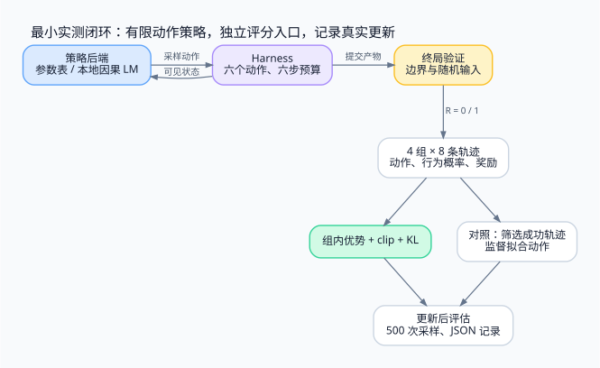

> 用六个工具动作跑通采样、终局评分、组内优势、裁剪更新和评估。先验证参数确实被结果更新了，再接本地语言模型；同时用成功轨迹 SFT 做对照，并说清这个实验能证明什么、不能证明什么。

<!-- more -->

**系列导航**

1. [为什么需要 Agent RL](/machine-learning/agent-rl/why-agent-rl/)
2. [从工具调用到可训练轨迹](/machine-learning/agent-rl/trajectory/)
3. [从 PPO 到 GRPO](/machine-learning/agent-rl/policy-optimization/)
4. [长轨迹上的信用分配](/machine-learning/agent-rl/credit-assignment/)
5. [GPU 训练与 CPU 环境如何协同](/machine-learning/agent-rl/training-system/)
6. [安全隔离与 Harness 解耦](/machine-learning/agent-rl/isolation/)
7. **跑通一个可验证的训练闭环（本文）**

---

## 1. 这次实验的尺度

> 实验要验证的是训练链路本身是否正确，而不是模型能力。所以每一部分都缩小到可以完整检查的规模。

前六篇定义了训练对象、轨迹、算法和工程边界。这一篇把最小闭环真正跑起来，而不是再写一段省略了环境和优化器的伪代码。

配套代码在 [GitHub 上的 mini 目录](https://github.com/Zqzqsb/Blog/tree/master/MachineLearning/AgentRL/mini)，提供两个策略后端：

| 后端 | 更新什么 | 本文验证到哪里 |
|---|---|---|
| `table` | 一个可训练的离散策略参数表 | CPU 上完成训练、三组随机种子与 SFT 对照 |
| `hf` | 本地 Hugging Face 因果语言模型的参数 | 用临时创建的微型随机 GPT-2 完成离线接口与训练循环检查 |

主实验没有训练预训练 LLM，也没有部署 GPU 集群。表格策略让计算、环境和评估都可以逐项检查，随机微型语言模型用来验证接入代码。它们证明的是链路正确，不是代码 Agent 的能力提升。



## 2. 环境缩小了什么，保留了什么

> 动作空间缩到六个，但「公开测试通过 ≠ 任务完成」和「终局私有验证」这两个关键结构保留了下来。

任务仍然是修复二分查找的 `low` 和 `high` 更新。为了不引入通用编辑器和任意代码执行，环境把这两处代码表示成有限的几个变体，并提供六个动作：

```text
read       读取当前代码状态
fix_low    将 low 更新设为 mid + 1
fix_high   将 high 更新设为 mid - 1
undo_low   将 low 更新改回 mid
test       执行公开 smoke test
finish     提交当前产物
```

每次工具调用最多推进一步，单条轨迹有六步预算。环境每一步都公开当前的两行代码，所以这个缩小版本是完全可观察的；表格策略以「当前代码变体 + 步数」作为索引。状态表示和修复动作都是人工设计的，难度远低于在仓库里定位问题并生成补丁。

公开 smoke test 只检查在 `[1, 3, 5]` 中查找 `3`，错误的实现也能通过，这正是为了体现「公开测试通过」不等于任务完成。终局验证另外检查空数组、边界、缺失目标和随机数组；候选算法有迭代上限，避免错误的边界让实验卡死。

在预算内 `finish` 且终局检查通过记 1，其余正常结束都记 0，包括用满六步仍未提交。这是本实验显式选择的任务契约。

## 3. 代码怎样分开环境与训练

> harness 只认识工具动作，训练器在回合结束后才拿产物去评分。职责的划分和第五、六篇一致，只是还待在同一个进程里。

| 文件 | 内容 |
|---|---|
| [environment.py](https://github.com/Zqzqsb/Blog/blob/master/MachineLearning/AgentRL/mini/environment.py) | 固定候选算法、harness 与独立调用的验证函数 |
| [train.py](https://github.com/Zqzqsb/Blog/blob/master/MachineLearning/AgentRL/mini/train.py) | 策略后端、采样、优势、更新、评估和 JSON 记录 |
| [test_demo.py](https://github.com/Zqzqsb/Blog/blob/master/MachineLearning/AgentRL/mini/test_demo.py) | 环境、评分、概率重放与梯度行为测试 |
| [smoke_hf.py](https://github.com/Zqzqsb/Blog/blob/master/MachineLearning/AgentRL/mini/smoke_hf.py) | 无需下载模型的本地语言模型接口检查 |
| [results](https://github.com/Zqzqsb/Blog/tree/master/MachineLearning/AgentRL/mini/results) | 实际运行的配置、运行时版本、逐步指标与评估 |

同名的结果文件会被覆盖，个人实验建议加 `local-` 前缀。示例不保存可部署的 checkpoint，每次重新运行都从初始策略开始。

`Harness.step()` 只接受工具动作并返回观察，它不知道 group、策略版本、优势或优化步数。训练器在回合结束后拿到产物，再调用验证器，把奖励写进训练记录。

这些对象都在同一个 Python 进程里，所以这只是代码职责上的边界，挡不住任意代码读取内存。这也是为什么环境只开放六个预定义动作、不执行任何生成的代码。要扩展成通用的 shell Agent，需要按第五、六篇拆成可信控制层、工具沙箱和独立评分层。

## 4. 运行 CPU 实验

> 一条命令跑测试，两条命令分别跑 RL 和 SFT。运行时信息都写进结果 JSON，方便对照。

在博客工作区执行，需要 Python 和 PyTorch：

```bash
cd MachineLearning/AgentRL/mini
python3 -m unittest -v test_demo.py
python3 train.py --seed 7 --output results/local-grpo-7.json
python3 train.py --method rs-sft --seed 7 --output results/local-sft-7.json
```

仓库里保留的主实验使用 Python 3.12.4、PyTorch 2.12.0+cu130，实际在 CPU 上运行，`torch.set_num_threads(1)`。精确的运行时信息也写在每份 JSON 里。不同的 PyTorch 构建或平台不保证逐位复现。

默认设置如下：

```text
策略：24 个可见状态索引 × 6 个动作，初始 logits 全为 0
训练轮数：100
每轮：4 组 × 每组 8 条轨迹，共 32 条
每批优化：2 次
学习率：0.08，Adam
clip：0.2
参考策略 KL 系数：0.02
每次评估：500 条轨迹，使用固定的评估采样种子
单条轨迹动作上限：6
```

24 个状态索引来自 6 种「已执行步数」乘以 4 种代码组合。两种方法各收集 3200 条训练轨迹，但工具调用总数、保留的样本数和反向传播的工作量仍然可能不同。

## 5. 一次更新究竟做了什么

> 这是在有限动作上借用 GRPO 的优势和目标结构，而不是自由生成文本的逐 token GRPO。正因为动作有限，KL 可以精确计算。

采样阶段关闭梯度，按当前的动作分布采样，记录每次选择的状态、动作和行为 logprob。所有组都采完后才更新，所以一批数据里的策略版本是固定的。

组内优势用总体标准差计算，奖励全同的组优势置零。损失先在一条轨迹的各个动作位置上平均，再对轨迹平均。核心计算是：

```python
ratio = exp(current_logp - old_logp)
objective = min(ratio * advantage,
                clip(ratio, 1 - epsilon, 1 + epsilon) * advantage)
loss = -objective + beta * kl
```

这是有限工具动作上的组内裁剪策略梯度，借用了 GRPO 的优势和目标结构，并不是在自由生成的 LLM 上逐 token 实现的完整 GRPO。这个区别同样适用于后面的 `hf` 后端。

因为只有六个动作，KL 可以直接对完整分布求和：

$$
\mathrm{KL}(\pi_\theta \,\|\, \pi_{\text{ref}}) = \sum_a \pi_\theta(a \mid h)\,\big[\log \pi_\theta(a \mid h) - \log \pi_{\text{ref}}(a \mid h)\big]
$$

参考策略从初始模型复制并冻结。同一批轨迹重复更新时，行为 logprob 不变，当前 logprob 每次重新计算。即使某一组已经全对，KL 项仍然可能产生梯度。

## 6. 实测结果：这个任务上 RL 并不比 SFT 强

> 两种方法都学会了这个小任务。动作空间这么小，成功率逼近上限是预期之内的事，差异不足以支持优劣结论。

在同一个环境里，分别运行组内裁剪更新和迭代式的成功轨迹 SFT。SFT 每轮也采样 32 条，只保留成功轨迹，对动作的负对数似然做两次更新，不使用 RL 版本的 KL 惩罚；某一轮没采到成功轨迹就跳过更新。

| 随机种子 | 初始成功率 | 组内裁剪更新后 | 成功轨迹 SFT 后 |
|---|---:|---:|---:|
| 7 | 5.8%（29/500） | 99.6%（498/500） | 99.8%（499/500） |
| 19 | 6.4%（32/500） | 100%（500/500） | 99.2%（496/500） |
| 42 | 5.8%（29/500） | 99.6%（498/500） | 100%（500/500） |

原始记录：[GRPO 7](https://github.com/Zqzqsb/Blog/blob/master/MachineLearning/AgentRL/mini/results/seed-7.json)、[19](https://github.com/Zqzqsb/Blog/blob/master/MachineLearning/AgentRL/mini/results/seed-19.json)、[42](https://github.com/Zqzqsb/Blog/blob/master/MachineLearning/AgentRL/mini/results/seed-42.json)；[SFT 7](https://github.com/Zqzqsb/Blog/blob/master/MachineLearning/AgentRL/mini/results/rs-sft-7.json)、[19](https://github.com/Zqzqsb/Blog/blob/master/MachineLearning/AgentRL/mini/results/rs-sft-19.json)、[42](https://github.com/Zqzqsb/Blog/blob/master/MachineLearning/AgentRL/mini/results/rs-sft-42.json)。

每组评估只有 500 次，几个百分点以内的差异说明不了谁更好；两种方法的正则项和实际梯度计算量也没有完全对齐。

一个更有意思的差别在动作数上。以种子 7 为例，训练后 RL 版本平均执行 4.164 个动作，SFT 只要 3.042 个。RL 版本没有显式的动作成本，KL 约束又让它保留了更多初始的随机行为。这个数字说明的是这组设置下的表现，不是算法的普遍性质。

这里的「评估」仍然是同一个修复任务上的新采样，只是验证器换了一组随机输入。它检查的是更新后的任务成功率，不是在没见过的仓库、没见过的 bug 上的泛化。

## 7. 接入本地语言模型时，策略定义变了

> 让 LLM 对六个候选动作打分再归一化，得到的是一个六分类策略，和让模型自由生成文本是两种不同的策略。

`hf` 后端加载本地的因果语言模型，默认不允许自动下载，也不允许远程自定义代码。它把环境历史写成 prompt，然后对六个候选动作字符串分别计算条件对数概率：

$$
s_\theta(a, h) = \sum_j \log p_\theta\big(c_j^{(a)} \,\big|\, \text{prompt},\ c_{<j}^{(a)}\big), \qquad
\pi_\theta(a \mid h) = \operatorname{softmax}_a\, s_\theta(a, h)
$$

$c^{(a)}$ 是动作 $a$ 的候选 token 序列，包括动作名称和 EOS。求和只覆盖候选 token 的预测位置，prompt 不作为目标标签，但模型仍然要通过处理 prompt 才能得出动作的概率。

之后从这个六分类分布里采样，用动作级的 logprob 计算比率和 KL。由于对候选做了重新归一化，这个策略既不同于让 LLM 自由生成，也不等于把原始的动作字符串概率直接当成归一化概率。候选的长度偏好同样由这个定义决定。

用自己的本地 checkpoint 可以执行：

```bash
python3 train.py --backend hf --model /absolute/path/to/local-model \
  --device cuda --iterations 2 --groups 1 --group-size 8 \
  --epochs 1 --eval-episodes 8 --lr 1e-6 \
  --output results/local-hf.json
```

这是一条小规模的接入命令，不是验证过的 GPU 配置。实现采用全参数训练，还要复制一份冻结的参考模型，外加优化器状态和激活的内存，所以不能据此推断某个参数规模能在单卡上跑。长 prompt 还要检查模型的上下文上限。建议先用能放进本机的小模型，再考虑 LoRA、批处理和分布式训练。

如果只有 CPU、也没有本地预训练权重，可以运行：

```bash
python3 smoke_hf.py
```

脚本会临时创建一个随机初始化的微型 GPT-2 和 tokenizer，检查本地加载、动作分布归一化、反向传播和一轮训练，然后删除临时模型。这项检查已经通过，结果在 [hf-smoke.json](https://github.com/Zqzqsb/Blog/blob/master/MachineLearning/AgentRL/mini/results/hf-smoke.json)。它证明接口能跑通，不衡量语言理解或修 bug 的能力。

## 8. 测试覆盖了哪些容易出错的边界

> 奖励曲线上涨证明不了训练器是对的，一个有 bug 的训练器在简单任务上也能画出漂亮的曲线。链路正确性要靠单元测试来保证。

单元测试检查：

- 只修一处不能通过私有验证，公开测试通过不能替代私有评分；
- 不同环境互不污染，预算耗尽和终止之后的调用都符合契约；
- 优势的数值和第三篇算出来的一致，奖励全同的组不会产生 NaN。

梯度测试还检查：

- clip 在正负优势下的不对称行为；
- 采样时记录的 logprob 能否用原策略重算出来；
- 一次更新会改变策略，但不改变参考模型；
- SFT 会忽略纯失败的样本。

## 9. 从最小闭环走向真实 Agent RL

> 动作空间、环境、评估三样东西逐一替换成真实的，每替换一样都会引入前面几篇讨论过的一类问题。

**先替换动作空间。** 让模型生成真实的工具名称和参数，保留每段的 token 和采样概率，并对外部观察做 loss mask。重新检查训练和推理在模板、上下文截断和采样分布上是否一致（第二、三篇）。

**再替换环境。** 从有限的代码变体换成真实仓库，使用第五、六篇的环境池、隔离执行和可信验证。网络重试、进程失败和资源预算都要进入数据契约。

**最后替换评估。** 按仓库或任务家族划分训练集和评估集，控制近似重复补丁造成的泄漏；对比固定模型的推理基线、成功轨迹 SFT 和 RL，报告训练成本、推理预算、任务成功率和波动。只有到这一步，才能回答训练是否带来了值得付费的真实能力提升。

本系列的实验验证了「参数确实被结果更新」这一件事。GPU 集群的吞吐、任意代码的安全执行、真实 LLM 的泛化，是另外三项需要分别实现和测量的工作。

## 参考资料

- [PyTorch Autograd](https://pytorch.org/docs/stable/autograd.html)：自动求导与梯度计算。
- [Transformers：本地模型加载](https://huggingface.co/docs/transformers/main/en/models)：模型配置与加载接口，具体行为依版本而定。
- [DeepSeekMath](https://arxiv.org/abs/2402.03300)：本例组内优势和裁剪目标的来源；本文的有限动作实现有意缩小了问题。

---

上一篇：[Agent RL（六）：安全隔离与 Harness 解耦](/machine-learning/agent-rl/isolation/)

配图源文件：[Graphviz DOT](https://github.com/Zqzqsb/Blog/blob/master/MachineLearning/AgentRL/assets/07-experiment.dot)。
