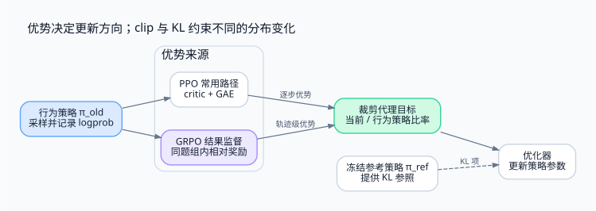

> PPO 和 GRPO 要回答的是同一个问题：一次选择比基线好多少。PPO 通常训练一个 critic 来给出基线，GRPO 则用同一道题的一组采样互相比较。在此之上，clip、KL、长度归一化各自管着不同的事，名字相同的算法，实际优化的目标可能并不相同。

<!-- more -->

**系列导航**

1. [为什么需要 Agent RL](/machine-learning/agent-rl/why-agent-rl/)
2. [从工具调用到可训练轨迹](/machine-learning/agent-rl/trajectory/)
3. **从 PPO 到 GRPO（本文）**
4. [长轨迹上的信用分配](/machine-learning/agent-rl/credit-assignment/)
5. [GPU 训练与 CPU 环境如何协同](/machine-learning/agent-rl/training-system/)
6. [安全隔离与 Harness 解耦](/machine-learning/agent-rl/isolation/)
7. [跑通一个可验证的训练闭环](/machine-learning/agent-rl/minimal-experiment/)

---

## 1. 奖励已经有了，为什么还需要优势

> 「得了 1 分」本身说明不了这次选择有多好，还要看它比当前策略的平均水平好多少。这个差值就是优势。

第二篇已经收集到了轨迹、生成概率和终局奖励。现在固定那道二分查找任务，用策略 $\pi_{\text{old}}$ 独立采样 8 次：

```text
轨迹       τ1 τ2 τ3 τ4 τ5 τ6 τ7 τ8
私有奖励    1  1  0  0  0  1  0  0
```

最直接的策略梯度，是用回报乘以生成动作的对数概率梯度：成功轨迹里的选择被鼓励，零回报的轨迹没有直接的奖励梯度。但同样是得 1 分，对一道几乎必过的题和一道几乎不会做的题，意义完全不同，需要的改进幅度也不同。

所以通常用回报减去一个基线，得到优势：

$$
A_t = G_t - b(h_t)
$$

$G_t$ 是从当前位置往后累计的回报。只要基线不依赖当前采样的动作，减去它就不会改变梯度的期望，却能降低估计的方差。实际算法还会叠加估计、标准化等近似，所以并不是每一种优势构造都能直接称为无偏。

两种算法的第一个区别就在这里：PPO 通常用价值模型给出与状态相关的基线；GRPO 的结果监督版本则用同一道题的一组采样，构造轨迹级的相对信号。

## 2. 先分清当前策略、行为策略和参考策略

> 三个策略各有用途：一个在被优化，一个产生了样本，一个用来约束漂移。混用它们，比率和 KL 都会算错。

| 符号 | 用途 | 何时变化 |
|---|---|---|
| $\pi_\theta$ | 正在计算梯度的当前策略 | 每次优化更新之后 |
| $\pi_{\text{old}}$ | 产生当前这批训练样本的行为策略 | 下一批采样，或行为版本切换时 |
| $\pi_{\text{ref}}$ | 约束分布漂移的参照 | 通常在一段训练期间冻结 |

行为策略和参考策略在第一步可能恰好是同一个模型，但职责不同。同一批样本被优化多次时，当前策略已经变了，而 `old_logprob` 必须始终对应采样时的那个模型。

对一个已经采到的生成 token，定义概率比：

$$
\rho_t(\theta) = \frac{\pi_\theta(a_t \mid h_t)}{\pi_{\text{old}}(a_t \mid h_t)} = \exp\!\big(\log \pi_\theta(a_t \mid h_t) - \texttt{old\_logprob}_t\big)
$$

这里默认采样时用的分布和记录下来的分布是同一个。推理服务的温度、截断采样等变换，必须体现在这个分母里。

## 3. PPO：优势估计与裁剪目标

> clip 裁剪的是优化的激励，而不是把真实的概率比锁在区间里。它让一批样本可以安全地多用几次，但并不是对步长的硬约束。

PPO 常用价值模型 $V(h_t)$ 估计未来回报，再用 GAE 计算优势（第四篇会展开）。critic 的拟合损失和策略损失通常一起训练；价值头可以和策略共享骨干，也可以是独立的模型，资源成本取决于具体实现。

PPO 的裁剪代理目标是最大化：

$$
L^{\text{clip}} = \mathbb{E}_t\Big[\min\big(\rho_t A_t,\ \mathrm{clip}(\rho_t, 1-\epsilon, 1+\epsilon)\, A_t\big)\Big]
$$

取 $\epsilon = 0.2$，分四种情况看：

| 优势 | 比率 | 裁剪项的作用 |
|---|---|---|
| $A > 0$ | $\rho > 1.2$ | 不再奖励继续提高这个概率 |
| $A > 0$ | $\rho < 0.8$ | 仍然推动它向正确方向恢复 |
| $A < 0$ | $\rho < 0.8$ | 不再奖励继续降低这个概率 |
| $A < 0$ | $\rho > 1.2$ | 仍然对错误方向施加梯度 |

规律是：**只有在比率已经朝着优势指示的方向走得够远时，梯度才被截断；走反了的情况始终保留梯度。** 被截断的只是「继续推」的激励。参数共享、其他 token 的梯度、多次更新和额外的损失项，仍然可能让比率越出区间；它也不构成对参数步长或 KL 的硬约束。

所以实践中还要盯着实际的 KL、概率比的分布、梯度范数和更新次数，必要时减少更新轮数或提前停止。



## 4. GRPO：把八条结果转成两个优势值

> GRPO 用同题组内的相对排名代替 critic。省掉的是价值模型，换来的代价是每道题要多采样几条轨迹。

以 DeepSeekMath 的结果监督形式为例，GRPO 不训练 critic，而是在同一道题的组内计算：

$$
\begin{aligned}
\bar{r} &= \tfrac{3}{8} = 0.375 \\
\sigma &= \sqrt{\tfrac{1}{8} \textstyle\sum_i (r_i - \bar{r})^2} \approx 0.484123 \\
A_i &= \frac{r_i - \bar{r}}{\sigma + \epsilon_{\text{num}}}
\end{aligned}
$$

$\epsilon_{\text{num}}$ 只是防止除零的数值项，和 PPO 的裁剪参数无关。忽略它之后：

$$
A_{\text{通过}} = \frac{1 - 0.375}{0.484123} \approx 1.290994, \qquad
A_{\text{失败}} = \frac{0 - 0.375}{0.484123} \approx -0.774597
$$

这里用的是总体标准差；如果实现用样本标准差，数值会略有不同。在结果监督下，$A_i$ 被广播到轨迹 $i$ 里所有参与策略损失的生成位置上，工具观察不在其中。

如果 8 条全对或全错，减去均值之后分子全是零。带数值保护的实现会让整组优势为零，不加保护则可能得到 NaN。此时来自任务奖励的策略梯度消失了；但如果还保留 KL 等辅助项，总梯度并不一定为零。

这也说明「不需要 critic」并不是免费的：要为每道题采样多条轨迹，用环境执行和推理计算去换组内比较。

## 5. KL 在约束哪一次漂移

> clip 约束的是「这一批样本复用时」的局部更新，KL 约束的是「相对起点」的长期偏离。两者参照的策略不同。

经典 RLHF 常把相对参考模型的 KL 惩罚放进奖励里，再让价值模型去拟合这个回报；一些 GRPO 目标则直接把 KL 放进策略损失。具体是哪一种，要看实际的目标函数，不能只凭算法名称推断。

一个简化的 GRPO 最大化目标可以写成：

$$
J = \frac{1}{G} \sum_{i=1}^{G} \frac{1}{L_i} \sum_{t \in \text{gen}(i)} \Big[\min\big(\rho_{i,t} A_i,\ \mathrm{clip}(\rho_{i,t}, 1-\epsilon, 1+\epsilon)\, A_i\big) - \beta\, K_{i,t}\Big]
$$

$L_i$ 是轨迹 $i$ 中参与训练的生成 token 数。KL 项参照的是 $\pi_{\text{ref}}$，clip 里的比率参照的是 $\pi_{\text{old}}$：前者约束策略长期偏离起点，后者控制同一批样本被复用时的局部更新。

GRPO 常用的非负 KL 估计是：

$$
k(a) = \frac{\pi_{\text{ref}}(a \mid h)}{\pi_\theta(a \mid h)} - \log \frac{\pi_{\text{ref}}(a \mid h)}{\pi_\theta(a \mid h)} - 1
$$

当两个分布有共同的支撑集、且 $a$ 从 $\pi_\theta$ 采样时，它的期望等于 $\mathrm{KL}(\pi_\theta \,\|\, \pi_{\text{ref}})$。复用 $\pi_{\text{old}}$ 的样本之后，这个无偏性就需要重新审视：要看实际的采样分布是谁，以及实现是否做了相应的校正。

第七篇的实验只有 6 个动作，可以直接对完整的离散分布求 KL，绕开了这个估计问题。大词表的 LLM 则必须明确采用哪种估计、付出多少计算。

## 6. 长度归一化实际在给谁分配权重

> 先在轨迹内平均，还是在整个 batch 上平均，决定了长轨迹和短轨迹各占多少权重。同叫 GRPO，优化的可能不是同一个损失。

假设两条轨迹都失败、优势相同，一条生成了 4 个 token，另一条生成了 12 个。

- **先在每条轨迹内对 token 平均，再对轨迹平均**：两条轨迹的总权重相同，长轨迹里每个 token 分到的权重更小。
- **对整个 batch 的有效 token 直接平均**：长轨迹包含更多项，在其他条件相同时，它的总权重与长度成正比。

具体代码还要检查归一化的范围是单组、整个 batch，还是分布式的全局 batch。在 token 数不同的多个 worker 上先局部平均再平均，也会改变目标。

长度归一化、标准差归一化、KL 的放法、截断的处理方式，每一项都会改变训练压力。两份都叫 GRPO 的实现，实际优化的可能是不同的损失。

## 7. DAPO 改了哪些实际问题

> DAPO 针对长推理训练中的几个具体问题做了调整。每一项都有它的适用前提，搬到代码 Agent 环境里需要重新验证。

**Clip-Higher。** 把裁剪的上下界分开，比如下界参数 0.2、上界参数 0.28，给正优势的选择留出更大的概率上升空间。它仍然是代理目标上的裁剪。

**动态采样。** 丢掉组内奖励完全相同的题目，继续采样，直到凑够有区分度的组。在工具环境里，这可能消耗大量交互预算，所以实现上需要设置尝试上限，并监控有效组的比例。

**Token 级损失聚合。** 改用有效 token 聚合，修正按轨迹平均带来的长度权重问题。工程上必须保证跨 microbatch、跨设备时分母一致。

**超长输出处理。** 论文讨论了对截断样本的噪声过滤和软长度惩罚。「没有在预算内完成」怎么计入目标，要结合任务定义：有的任务里预算本身就是成功条件，有的截断来自系统限制，两者需要区别对待。

DAPO 在它的训练设置里还去掉了 KL 惩罚。这是针对具体任务和实验的选择，是否适用于 Agent RL 要另行判断。

## 8. DPO 与成功轨迹 SFT 放在哪里

> 三条路线的区别不只在目标函数，还在于数据怎么来、失败样本怎么用、环境预算花在哪里。

如果对 DPO 还不熟，可以先读番外[DPO 到底补充了什么](/machine-learning/agent-rl/dpo-background/)。它只补充概念定位，不是本篇和后续文章的前置条件。

**成功轨迹 SFT** 先筛出高分轨迹，再拟合它们的生成 token。失败轨迹只用于过滤，不会作为负优势进入目标。

**DPO** 消费的是同一输入下的偏好对，比如一条成功轨迹和一条失败轨迹。它更新的是相对参考策略的对数概率差，不需要 PPO 的行为策略比率，也不需要 GRPO 的组内标准差；单次偏好更新本身不需要重新执行环境。在线或迭代版本的 DPO 则可以在轮次之间重新采样和标注。

所以要准确比较这几条路线，需要同时说清：数据怎样生成，单次更新用什么目标，失败样本怎样参与，以及环境预算花在哪里。

到这里，训练器已经能提高高优势轨迹的概率了。但一条成功的轨迹里可能有不必要的绕路，甚至有真正的错误操作；给它的所有生成位置同一个优势，并没有回答「到底哪一步值得奖励」。下一篇进入这个时间维度上的问题。

## 参考资料

- [PPO](https://arxiv.org/abs/1707.06347)：裁剪代理目标及其局限。
- [DeepSeekMath](https://arxiv.org/abs/2402.03300)：GRPO、结果监督与过程监督的定义。
- [DAPO](https://arxiv.org/abs/2503.14476)：动态采样、非对称裁剪、token 级聚合与超长输出处理。
- [Approximating KL Divergence](http://joschu.net/blog/kl-approx.html)：常见 KL 估计的期望与方差性质。
- [DPO](https://arxiv.org/abs/2305.18290)：偏好对上的策略优化目标。

---

上一篇：[Agent RL（二）：从工具调用到可训练轨迹](/machine-learning/agent-rl/trajectory/)

下一篇：[Agent RL（四）：长轨迹上的信用分配](/machine-learning/agent-rl/credit-assignment/)

配图源文件：[Graphviz DOT](https://github.com/Zqzqsb/Blog/blob/master/MachineLearning/AgentRL/assets/03-optimization.dot)。
