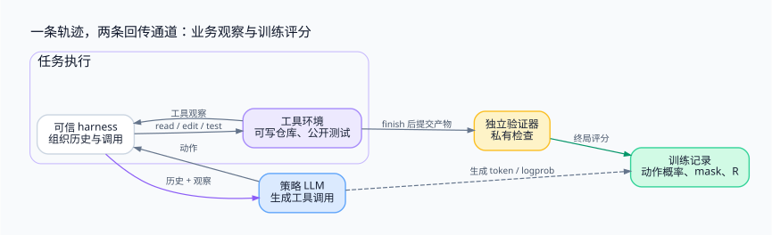

> 一条 Agent 轨迹要能用于训练，先得把四个角色拆开：模型、harness、可写环境、评分器。拆开之后才能回答几个关键问题：哪些是动作、哪些是观察，哪些 token 参与训练，一次失败究竟来自策略还是基础设施。

<!-- more -->

**系列导航**

1. [为什么需要 Agent RL](/machine-learning/agent-rl/why-agent-rl/)
2. **从工具调用到可训练轨迹（本文）**
3. [从 PPO 到 GRPO](/machine-learning/agent-rl/policy-optimization/)
4. [长轨迹上的信用分配](/machine-learning/agent-rl/credit-assignment/)
5. [GPU 训练与 CPU 环境如何协同](/machine-learning/agent-rl/training-system/)
6. [安全隔离与 Harness 解耦](/machine-learning/agent-rl/isolation/)
7. [跑通一个可验证的训练闭环](/machine-learning/agent-rl/minimal-experiment/)

---

## 1. 先给任务一个可执行的定义

> 「状态」「奖励」「成功」都要落到同一个具体任务上，否则后面每一篇说的可能都是不同的东西。

第一篇解释了为什么要按任务结果来训练。这一篇先把任务固定下来。下面这段二分查找有两个边界错误：

```python
def search(a, target):
    low, high = 0, len(a) - 1
    while low <= high:
        mid = (low + high) // 2
        if a[mid] == target:
            return mid
        if a[mid] < target:
            low = mid       # 应为 mid + 1
        else:
            high = mid      # 应为 mid - 1
    return -1
```

契约是：输入已排序且元素不重复，找到就返回下标，找不到返回 `-1`。这个错误程序在某些输入上碰巧是对的：在 `[1, 3, 5]` 里找 `3` 会通过；找 `6` 时，错误的 `low` 更新会让循环停滞；只修好 `low` 之后，找 `0` 仍然会卡在另一侧的边界。

开发环境给测试进程设了超时和迭代保护，日志如实报告「超过预算」，而不是伪造一个实际上不会出现的断言失败。

Agent 可以用四个工具：`read_file`、`edit`、`run_tests` 和 `finish`。`run_tests` 运行公开的开发测试；`finish` 提交补丁，触发一次独立的私有验证。**开发测试通过只是一个观察，私有验证的结果才是本例的终局奖励。**

## 2. 一条轨迹里发生了什么

> 模型、harness、环境、验证器、训练器各管一段。把它们统统叫作「模型的上下文」，会丢掉最关键的边界。

```text
1. read_file("search.py")
   ← 看见两个错误的更新分支
2. edit("low = mid", "low = mid + 1")
   ← patch applied
3. run_tests()
   ← 查找 6 已通过；查找 0 超过迭代预算
4. edit("high = mid", "high = mid - 1")
   ← patch applied
5. run_tests()
   ← 公开开发测试通过
6. finish()
   → 补丁提交给独立验证器
   → 私有验证通过，训练侧记录 R = 1
```

第 2 步之后测试仍有失败，但这一步本身是正确的局部修复，不是「让状态变差的错误动作」。真正的退步是另一种情况，比如把已经改对的 `low = mid + 1` 又改回 `low = mid`，第四篇会专门讨论这种轨迹。

这条轨迹里的各个角色分工如下：

- **harness** 接收模型的动作，调用对应的工具；
- **文件系统和进程**承载环境状态；
- **验证器**检查最终提交的产物；
- **训练器**消费轨迹和评分。



## 3. 状态不等于模型看到的文本

> 环境的完整状态远比模型看到的多。模型看到什么，是由接口和上下文整理策略决定的。

完整的环境可以用 MDP 描述：状态 $s_t$、动作 $a_t$、转移 $P(s_{t+1} \mid s_t, a_t)$ 和奖励。但 Agent 通常只能看到状态的一部分，所以用「部分可观察」的过程来理解更准确：

| 对象 | 本例中的内容 | 是否全部进入上下文 |
|---|---|---|
| 状态 | 仓库、后台进程、文件权限、测试环境 | 否 |
| 观察 | 文件内容、工具结果、日志、公开的退出状态 | 按接口返回的部分 |
| 历史 $h_t$ | 初始任务，以及此前的消息、动作和观察 | 受上下文窗口和整理策略限制 |
| 动作 | 模型生成的工具选择与参数、最终提交 | 是 |
| 私有评分 | 终局验证结果，以及可选的过程分数 | 本例中只进入训练侧 |

文件被改写之后，模型并不会自动看到新文件的全部内容。`edit` 返回的 `patch applied` 只是工具声称操作完成了；要获得新的证据，得再读一次文件或跑一次测试。

上下文压缩也会改变策略能看到的信息。如果采样时删掉了旧日志，训练重放时又把全部日志拼了回去，两次计算的就不是同一个条件分布。这不是可有可无的预处理细节，而是会直接改变训练目标的问题。

## 4. token 动作与工具动作怎样同时成立

> 模型按 token 生成，环境按工具调用执行。训练时可以按 token 算损失，但工具调用的边界必须保留下来。

语言模型是一个 token 一个 token 地生成的，而环境要等一整条工具调用连同参数都生成完才执行。于是两种时间尺度同时存在：

```text
模型时间： tool_name → argument token → argument token → 调用结束
环境时间：                           执行一次 edit → 返回观察
```

可以把一整条调用看作一个宏观动作，它的条件概率就是组成这条调用的各个生成 token 的概率之积。训练实现也可以直接在生成 token 上算损失，但必须保留工具调用的边界，否则观察、终止和过程奖励都对不齐。

按完整的环境轨迹写，轨迹的概率是：

$$
p_\theta(\tau \mid x) = p(s_0 \mid x) \prod_k \pi_\theta(a_k \mid h_k)\, P(s_{k+1}, o_{k+1} \mid s_k, a_k)
$$

通常假设环境转移不依赖策略参数 $\theta$。对 $\theta$ 求对数梯度时，环境项消失，只剩下策略的生成项。这也说明「完整轨迹的概率」不等于「所有消息 token 的概率」：工具观察不是模型采样出来的文本，不该进入策略的似然。

## 5. 奖励有两个独立的分类维度

> 奖励可以按「什么时候给」和「谁来给」两个维度分类。可以自动算出来的数字，不一定就是正确的业务目标。

先问奖励在什么时候出现：只在终局给的结果奖励，还是在中间步骤也给的过程奖励。再问奖励由谁产生：程序验证，还是模型或人来判断。

| | 结果奖励 | 过程奖励 |
|---|---|---|
| 程序验证 | 私有测试是否通过 | 某类错误是否消除、某项状态检查是否改善 |
| 模型或人工判断 | 最终产物的质量 | 某一步检索、规划或操作是否合理 |

本例先用最简单的终局定义：正常提交且私有检查通过记 1，正常提交但检查失败记 0。预算耗尽怎么算，要单独写进任务契约，本系列的最小实验选择记 0。节点宕机、镜像拉取失败这类基础设施故障则单独标记，不能默默算成能力失败。

奖励里也可以加入成本，但这会改变任务目标本身：

$$
R(\tau) = \mathrm{success}(\tau) - \lambda \cdot \mathrm{tool\_cost}(\tau)
$$

$\lambda$ 设得太大，模型可能学会少做检查、提前结束。

## 6. 训练侧必须保留哪些数据

> 只有最终的聊天文本和一个分数，无法可靠地重放训练。模型可见的数据和训练元数据要分开存。

一条可用于训练的轨迹记录，大致长这样：

```json
{
  "task_id": "binary-search-001",
  "rollout_id": "r-003",
  "attempt_id": "a-001",
  "policy_version": "v-012",
  "environment_version": "image-and-repo-digest",
  "segments": [
    {
      "input_ids": [101, 202],
      "generated_ids": [303, 404],
      "old_logprobs": [-0.7, -0.4],
      "tool_call_id": "c-001"
    }
  ],
  "termination": "finished",
  "reward": 1.0
}
```

token ID 只是示意。实际记录还需要 tokenizer 和聊天模板的版本、采样配置、工具参数和结果、产物摘要、时间戳，以及评分器版本。

其中最容易出错的是 `old_logprobs`。它必须和优化目标所定义的行为策略一致。temperature、top-k / top-p、约束解码都会改变实际的采样分布；如果样本来自一个变换过的分布，分母却用原始模型的 softmax，就需要说清楚算法采用了哪种近似或校正。最稳妥的起点是固定采样规则，不要在不同服务里悄悄改变它。

拼接训练序列时，loss mask 只选出参与策略优化的生成位置；提示词、工具观察和 padding 都不算模型的动作。还要注意自回归预测的一位偏移：位置 $t-1$ 的 logits 预测的是位置 $t$ 的 token。

## 7. 重试、独立采样与结束原因

> 同题多次采样要从干净的环境开始，同一次调用的网络重试要保证不重复执行。结束原因要分清，否则训练信号会混进系统故障。

GRPO 会对同一道题采样多条轨迹。每一条都必须从相同的任务定义、独立的可写环境开始：前一条修过的文件不能被下一条继承，共享的编译缓存也不能泄漏补丁或答案。

同一次工具调用的网络重试是另一回事。它应该带一个稳定的调用标识，避免一次 `edit` 被执行两遍。还有一种更棘手的情况：进程已经改了文件，却在调用结果持久化之前崩溃了。这时单靠去重表不够，要么检查实际状态，要么废弃这个环境、从干净快照重跑。

结束记录至少要区分以下几种原因：

| 结束原因 | 能否直接作为任务奖励 |
|---|---|
| 正常提交 | 可以，按产物评分 |
| 达到任务规定的动作或时间预算 | 按任务契约里写明的规则处理 |
| 无效调用 | 按协议记录，并决定是否允许恢复 |
| 基础设施故障 | 标为无效或重试，不进入策略信号 |
| 外部取消 | 单独处理，不伪装成正常的失败 |

这些字段决定了公式到底是在优化模型行为，还是在拟合系统故障。它们和算法公式一样属于训练的核心部分。

## 参考资料

- [ReAct](https://arxiv.org/abs/2210.03629)：行动与环境观察交替的轨迹结构。
- [SWE-bench](https://arxiv.org/abs/2310.06770)：以代码仓库、补丁和测试组织任务的实例。
- [Gymnasium：处理时间截断](https://gymnasium.farama.org/tutorials/gymnasium_basics/handling_time_limits/)：termination 与 truncation 对学习信号的影响；具体 Agent 任务还需要自行定义预算契约。

---

上一篇：[Agent RL（一）：为什么需要 Agent RL](/machine-learning/agent-rl/why-agent-rl/)

下一篇：[Agent RL（三）：从 PPO 到 GRPO](/machine-learning/agent-rl/policy-optimization/)

配图源文件：[Graphviz DOT](https://github.com/Zqzqsb/Blog/blob/master/MachineLearning/AgentRL/assets/02-trajectory.dot)。
