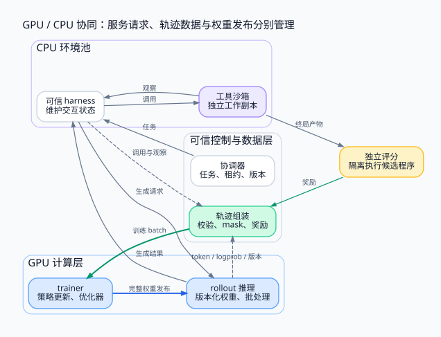

> Agent RL 系统的核心张力只有一个：想让 GPU 一直忙，就得让采样和训练重叠；想让样本可信，就得让样本来自当前的策略。所有的架构选择都是在这两者之间找位置，而策略版本号是让这个取舍可以度量、可以检查的唯一锚点。

<!-- more -->

**系列导航**

1. [为什么需要 Agent RL](/machine-learning/agent-rl/why-agent-rl/)
2. [从工具调用到可训练轨迹](/machine-learning/agent-rl/trajectory/)
3. [从 PPO 到 GRPO](/machine-learning/agent-rl/policy-optimization/)
4. [长轨迹上的信用分配](/machine-learning/agent-rl/credit-assignment/)
5. **GPU 训练与 CPU 环境如何协同（本文）**
6. [安全隔离与 Harness 解耦](/machine-learning/agent-rl/isolation/)
7. [跑通一个可验证的训练闭环](/machine-learning/agent-rl/minimal-experiment/)

---

## 1. 张力从哪里来

> 工具调用把一条轨迹切成了「GPU 生成」和「CPU 执行」交替的片段。同步就要等最慢的环境，异步就会用旧策略采样，两头都有代价。

纯文本生成可以一口气解码到结束。代码 Agent 不行：它生成一条测试命令之后，要等 CPU 创建进程、读文件、编译、跑测试，拿到结果才能继续生成下一轮。

这带来两种极端：

- **完全同步**：一批轨迹全部跑完、评完分，trainer 才更新，然后发布新权重，再采下一批。数据来源干净，但 GPU 要等这一批里最慢的那个环境，长尾越重，空转越多。
- **完全异步**：采样和训练各跑各的，GPU 一直有活干。代价是轨迹回来时 trainer 可能已经更新了好几次，样本来自旧策略；如果管理不好，还会出现一条轨迹混着几个版本、任务重复执行、资源被耗尽。

工程上真正要做的，是在两个极端之间选一个点，并且能说清楚这个点放宽了什么、怎么监控。



## 2. 先拆开四类数据流

> 四类数据流的一致性要求差别很大。把它们混在一起管理，最严格的那条要求就会拖累所有流。

一个参考架构包含以下组件。逻辑上分开不等于物理上要三套集群，小规模时完全可以共享机器、分时使用 GPU。

| 组件 | 职责与持有的数据 |
|---|---|
| 任务协调器 | 任务队列、预算、租约、重试、rollout / attempt 标识 |
| rollout 推理服务 | 某个版本的模型权重、批处理与 KV cache |
| 可信 harness worker | 消息历史、工具调用状态机、模型接口适配 |
| 工具沙箱 | 单条轨迹的可写工作区与不可信进程 |
| 评分服务 | 私有检查定义、产物验收、受控的验证执行 |
| trainer 与数据管道 | 轨迹校验、优势与损失、优化器状态、权重发布 |

组件之间流动的数据可以分成四类，各自的要求很不一样：

| 数据流 | 典型实现 | 最在意什么 |
|---|---|---|
| trainer 内部的 GPU 通信 | NCCL 上的 all-reduce、reduce-scatter 等 | 带宽和延迟，拓扑要匹配并行方式 |
| trainer 向 rollout 发布权重 | checkpoint、设备间直传 | 版本的原子可见性 |
| harness 调用推理服务 | HTTP / gRPC | 吞吐、排队延迟、取消与超时语义 |
| 轨迹、奖励进入训练 batch | 对象存储加消息队列 | 记录完整、关联正确、不重复 |

把它们分开的直接好处是：CPU 工具集群不需要加入任何梯度集合通信，就能调用 GPU 推理服务；集合通信的拓扑优化只在 trainer 内部做，不会被环境的长尾拖住。

这里的 CPU / GPU 分工只是代码修复场景的常用起点。浏览器、图形任务或机器学习类的工具，同样可能需要 GPU。

## 3. 策略版本是整个系统的一致性锚点

> 权重、样本、logprob 能否对得上号，全靠 `policy_version` 这一个字段。它必须表示「这段生成真的来自这组权重」，而不只是一个标签。

第三篇的概率比 $\rho_t$ 有一个前提：分母 `old_logprob` 来自实际采样时的那组权重。在分布式系统里，保证这一点的只有策略版本。所以权重发布的关键不是传得多快，而是版本可见性的契约。

一个容易验证的发布协议是：

```text
1. trainer 完成版本 v 的更新，生成带摘要的权重清单
2. rollout 在备用实例上加载，或停止接收新任务后再加载
3. rollout 校验完整性，确认 tokenizer 和模型配置兼容
4. 服务报告 READY(v)
5. 协调器开始把新轨迹绑定到 v
6. 旧版本的轨迹全部结束后，释放旧实例
```

核心约束只有一条：同一组参数不能一边被覆盖、一边用于生成。否则 `policy_version = v` 就只是个标签，实际采样却可能混了好几个版本。这里的「原子」指完整模型在逻辑上同时变得可用，并不要求底层字节在同一时刻传完。

最简单的设计是一条轨迹从头到尾固定一个策略版本。这需要同时保留新旧两个版本，代价是显存；或者在更新前等旧轨迹全部结束，代价是同步停顿。如果允许轨迹中途换版本，就要为每个生成片段记录真实的行为分布，并重新审视算法对这种轨迹的假设，而不是在最后写一个最新的版本号了事。

## 4. 训练元数据走旁路，harness 不需要懂 RL

> harness 只负责 Agent 的事。训练需要的 token、logprob 和版本，由推理侧写入旁路，不经过模型可见的消息。

训练侧需要每次生成的 token ID、对应的 logprob 和实际的权重版本，但这些数据不该出现在模型能看到的消息里：

```text
模型可见：    任务、历史助手动作、工具观察
harness 使用：结构化工具调用、结束原因
训练侧旁路：  token IDs、behavior logprobs、权重版本、采样配置
```

做法是让推理代理为每次调用分配一个 `request_id`：生成结果返回给 harness，元数据写到轨迹收集器。这样 harness 的业务接口不需要理解 GRPO 的 group、优势或优化步数。换一个训练算法，harness 不用改；换一个 Agent 框架，训练侧也不用改。

推理服务自身还要区分几种结束：排队超时、生成超时、客户端取消、模型正常结束。工具返回特别长时要有明确的截断规则，而且生成端和训练端必须用同一套上下文重建规则，否则就会出现第二篇说的「采样和训练看到的不是同一个条件分布」。

连续批处理可以让等待工具的轨迹让出生成容量。但 KV cache 怎么保留、丢弃或迁移，受推理引擎和显存预算的约束；大量长上下文会把显存占满，容量不能只按并发请求数来规划。

## 5. 陈旧度是一个旋钮

> 异步不可避免地带来旧样本。关键是把「旧到什么程度还能用」写成显式规则，并用学习质量而不是吞吐来验证它。

同步版本固定一个策略采一批，等评分，更新若干步，再发布新模型。行为概率和数据来源都容易检查，代价是等最慢的环境。

异步版本让采样和更新重叠，资源利用率更高，同时引入了样本陈旧。接收一条轨迹的规则可以包括：策略版本差、墙钟时间、概率比的分布，以及训练目标本身的要求。

比如 `max_policy_lag = 2`，它是一个需要验证的工程选择，而不是普遍安全的阈值：版本只差一步，如果那一步更新很大，分布变化也可能很大；反过来，多次很小的更新之后，样本未必就不能用了。

PPO / GRPO 的局部概率比也不能修复所有 off-policy 的问题（第四篇第 8 节）。稳妥的顺序是：先把陈旧度限制住，监控有效梯度和评估结果，再一步步放宽并发。否则吞吐的提升很容易掩盖学习质量的下降。

## 6. 队列可以重投，副作用不能重放

> 消息队列通常只保证至少投递一次，而工具副作用需要恰好执行一次。两者之间的差距，要靠 attempt 标识、状态机和「废弃环境重来」来补。

大的日志和补丁放进对象存储，队列里只传索引和状态。每个事件都要能关联回去：

```text
task_id → rollout_id → attempt_id → tool_call_id / request_id
                          ↘ policy_version
                          ↘ environment_version
                          ↘ verifier_version
```

轨迹本身用一个明确的状态机管理：

```text
PENDING → LEASED → RUNNING → ARTIFACT_READY → SCORED → ACCEPTED
                     ↘ INFRA_FAILED / CANCELLED
```

租约超时后允许重新领取任务，但必须换一个新的 attempt 标识，旧 worker 迟到的结果按规则拒收。训练数据组装器要等轨迹结束、评分到齐、记录完整之后，才决定是否放进 batch，绝不能把两次重试的前半段和后半段拼成一条看起来成功的轨迹。

`edit` 和外部 API 调用要格外小心。可重复的文件替换可以先校验修改前的摘要；如果执行中断后无法确认状态，就销毁环境、重跑整条轨迹。业务工具如果支持幂等键，要沿着调用链一路传下去。

## 7. 容量规划：先找等待发生在哪里

> 加资源之前先确认瓶颈在哪。GPU 利用率高不等于学得多，CPU 加多了也可能只是把队列推到了推理端。

在负载稳定的近似下，Little 定律给出：

$$
\text{在途任务数} \approx \text{到达率} \times \text{平均停留时间}
$$

假设工具请求每秒到达 20 次，每次平均占用沙箱 5 秒，那么仅覆盖平均需求就要大约 100 个在途槽位；实际配置还要考虑尾延迟、突发流量和不同任务的资源差异。这只是估算示例，不是实测的集群指标。

环境并发加上去之后，如果瓶颈转移到推理端，再加 CPU 只会让队列更长。如果 GPU 忙着处理低价值的组，或者组内奖励全部相同的组，利用率再高也不一定带来有效的学习。

所以要分层同时观察：

| 层面 | 指标 |
|---|---|
| 推理 | prefill / decode 吞吐、排队时延、KV 占用 |
| 环境 | 工具耗时分位数、启动成本、失败与超时率 |
| 数据 | 完整轨迹率、有效组比例、版本陈旧度、丢弃率 |
| 训练 | 优化步耗时、KL、梯度、概率比与评估成功率 |
| 成本 | 每条验收轨迹、每个有效组、每个评估成功任务的资源开销 |

其中「有效组比例」和「版本陈旧度」最直接地反映了第 1 节那个取舍现在落在哪里。

## 8. 用故障演练验证契约

> 上面每一条契约都对应一种可以主动注入的故障。演练能通过，比画一张巨大的部署图更能说明系统是对的。

- 让 worker 在工具执行之后、结果写入之前退出，确认系统不会悄悄重复副作用。
- 延迟一条评分结果，检查它会不会被错误地关联到别的 attempt。
- 发布一份损坏的权重清单，确认 rollout 不会报告就绪。
- 让一个环境无限等待，确认租约、取消和进程清理最终都能收敛。

第七篇从单进程闭环开始，验证的是算法和数据契约；扩展到集群时沿用本篇的接口，再用这些演练逐条确认分布式下的契约。

## 参考资料

- [NVIDIA NCCL 文档](https://docs.nvidia.com/deeplearning/nccl/user-guide/docs/)：GPU 集合通信与环境配置。
- [vLLM / PagedAttention](https://arxiv.org/abs/2309.06180)：推理服务的内存管理与批处理背景。
- [verl / HybridFlow](https://arxiv.org/abs/2409.19256)：大模型 RL 的计算与执行组织实例，具体配置以所用版本的文档为准。
- [Ray 架构与任务模型](https://docs.ray.io/en/latest/ray-core/walkthrough.html)：协调任务与 actor 的一种选择，不是本文协议的必要依赖。

---

上一篇：[Agent RL（四）：长轨迹上的信用分配](/machine-learning/agent-rl/credit-assignment/)

下一篇：[Agent RL（六）：安全隔离与 Harness 解耦](/machine-learning/agent-rl/isolation/)

配图源文件：[Graphviz DOT](https://github.com/Zqzqsb/Blog/blob/master/MachineLearning/AgentRL/assets/05-cluster.dot)。
