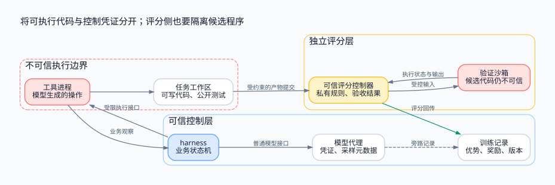

> 隔离的核心问题是信任边界画在哪里。划分原则只有一条：执行模型产出的地方就不可信，包括评分器；持有凭证、训练元数据和私有答案的东西，都要放在边界的另一侧。harness 解耦和安全隔离，其实是同一条边界的两面。

<!-- more -->

**系列导航**

1. [为什么需要 Agent RL](/machine-learning/agent-rl/why-agent-rl/)
2. [从工具调用到可训练轨迹](/machine-learning/agent-rl/trajectory/)
3. [从 PPO 到 GRPO](/machine-learning/agent-rl/policy-optimization/)
4. [长轨迹上的信用分配](/machine-learning/agent-rl/credit-assignment/)
5. [GPU 训练与 CPU 环境如何协同](/machine-learning/agent-rl/training-system/)
6. **安全隔离与 Harness 解耦（本文）**
7. [跑通一个可验证的训练闭环](/machine-learning/agent-rl/minimal-experiment/)

---

## 1. 「不感知自己在训练」其实是三个目标

> 前两个目标可以通过工程实现和测试来保证，第三个做不到。把它们混在一起谈，会让人高估隔离能提供的东西。

一个常见的愿景是：harness 在 CPU 容器里像平时一样调用模型、执行工具、整理观察，训练系统在外面记录轨迹、更新模型，harness 和模型都「不感知」训练的存在。这句话里其实混着三个目标：

| 目标 | 怎样实现与验证 |
|---|---|
| harness 代码不依赖训练算法 | 同一套业务接口接不同的模型后端，训练元数据由适配层管理 |
| 模型看不到不必要的训练信息 | 控制提示词、工具输出、文件、环境变量、进程与网络的可见范围 |
| 模型完全无法判断自己在训练 | 上述措施保证不了：任务分布、延迟、环境特征都可能提供线索 |

本文说的「训练透明」只指前两项。训练、评估和部署尽量复用同一套接口，可以减少分布差异；环境本来就不同的地方，要记录下差异并评估影响。

## 2. 边界按「谁在执行模型产出」来画

> 不是按组件叫什么名字来划分信任，而是看它会不会运行模型写出来的东西。评分器也会运行候选代码，所以它内部同样要切一刀。

代码 Agent 会生成补丁、shell 命令和工具参数。执行这些内容的进程可能读取环境、发起网络请求、耗尽资源、修改文件，甚至尝试干扰评分。即使模型没有任何「恶意」，错误的代码也能造成同样的后果。

需要保护的资产包括：其他任务、宿主机、训练控制面、推理服务的凭证、私有测试和评分逻辑。按上面的原则，参考设计分成三层：

1. **可信控制层**：协调器、推理代理、轨迹收集器，以及 harness 的控制部分。
2. **不可信执行层**：每条轨迹独立的工具沙箱、可写仓库和候选程序。
3. **独立评分层**：可信的评分控制器，加上同样被隔离的候选代码验证进程。

第三层最容易被忽视。「这是评测容器」并不能成为信任里面所有代码的理由：只要它要运行待测程序，就必须把「判定结果的控制器」和「被测的执行进程」分开。



## 3. harness 要切成两半

> harness 里维护状态机的部分是可信的，执行 shell 的部分是不可信的。把它们切开，安全和训练透明会同时得到改善。

如果一个容器既运行持有长期 API 密钥的 harness，又允许模型任意执行 shell，那么环境变量、配置文件、同用户的进程信息、本地端口，都可能把控制数据暴露出去。

所以要把 harness 切开：控制部分在可信 worker 里维护状态机，通过一个受限的执行接口，把工具调用发送到任务沙箱。沙箱里只有当前任务需要的数据，没有 trainer、对象存储管理端或推理控制面的长期凭证。

沙箱确实需要访问外部服务时，由可信代理提供短期、限定作用域的能力。代理负责校验任务身份、目标地址和预算，而不是把全局凭证塞进工具参数里。

这一刀同时实现了训练透明：沙箱不需要知道 checkpoint 路径、group id 或训练日志；harness 的业务逻辑也不需要知道这条轨迹会被用于 SFT、GRPO，还是只做评估。

## 4. 解耦靠接口，不靠提示词

> 训练字段从一开始就不出现在模型可见的消息里，而不是写进提示词让模型「忽略」它们。

接口可以停留在业务层：

```python
class ModelClient:
    def generate(self, messages, tools, limits):
        """返回助手消息或结构化工具调用。"""

class ToolRuntime:
    def execute(self, call_id, tool_name, arguments):
        """返回工具观察，不返回优化器或奖励字段。"""
```

训练模式下，模型代理额外写入采样 token、行为 logprob 和版本（第五篇第 4 节的旁路）；工具事件由可信收集器记录；产物交给验证服务，分数回到训练数据管道。部署时换成普通的模型后端，harness 执行的还是同一套逻辑。

需要记录的关联标识放在传输层或记录层，同时要避免它们被调试日志原样回显到工具输出里。

公开测试结果通常是合理的任务观察。私有评分要不要反馈给 Agent，则是一个显式的环境设计决定：如果每次编辑之后都能查询私有分数，环境就已经泄漏了额外的信息，而且这个接口可以被反复试探。

## 5. 评分器为什么也不可信

> 隐藏测试只读，只能防止被改，防不了被读、被绕过、被伪造。评分的可信度来自「谁来判定」，而不是「测试文件放在哪」。

只读只能阻止修改。如果模型能读到隐藏测试，它就能针对答案投机；如果待测代码能替换测试入口、注入依赖或伪造日志，验证器本身是只读的也保证不了奖励可信。

一个更稳妥的终局验证流程是：

```text
导出补丁
  → 校验路径、大小与文件类型
  → 从可信基线创建干净工作区
  → 按规则应用补丁
  → 在独立沙箱中运行候选程序
  → 由可信控制器采集结果并评分
```

补丁检查要处理绝对路径、`..`、符号链接和对测试入口的修改，而不只是比较字符串前缀。依赖锁定、启动命令和验证框架，也都要来自可信的配置。

可信控制器不能只解析候选程序打印出来的 `PASS`，要检查协议状态、真实的退出信息和测试断言。即便如此，和测试框架跑在同一个进程里的候选代码仍然可能干扰它；条件允许时，把输入生成和结果判定留在外部的监督进程里，只通过一个窄接口调用被测函数。

测试用例一旦交给程序执行，就可能被程序观察到，执行期间的输入不可能永远保密。能做的是：不提前泄漏测试定义和答案，限制可见的信息，防止候选程序改写裁判。有限的测试终归只是正确性的近似，还需要用独立的任务和新的输入来评估。

## 6. 容器配置只是边界的一部分

> 一段 securityContext 能收紧权限和资源，但管不了网络，也改变不了共享内核这个事实。隔离强度要和威胁模型匹配，并为此付出相应的代价。

下面是 Linux / Kubernetes 工具 worker 的部分限制示例，省略了镜像、卷和调度配置：

```yaml
spec:
  automountServiceAccountToken: false
  securityContext:
    runAsNonRoot: true
    runAsUser: 10001
    runAsGroup: 10001
    seccompProfile:
      type: RuntimeDefault
  containers:
    - name: tool-worker
      securityContext:
        allowPrivilegeEscalation: false
        readOnlyRootFilesystem: true
        capabilities:
          drop: ["ALL"]
      resources:
        requests:
          cpu: "1"
          memory: "1Gi"
        limits:
          cpu: "2"
          memory: "2Gi"
          ephemeral-storage: "4Gi"
```

它没有覆盖的部分同样重要：

- **可写区域**：任务工作区和临时目录需要单独的受限可写卷。
- **进程与输出**：要限制进程数、执行时长和输出量；终止工具时要清理整个进程组或 cgroup，而不只是启动它的父进程。
- **网络**：需要独立的网络策略，以及真正支持它的网络实现，`securityContext` 不会自动阻止出站访问。DNS、云元数据地址、集群内部服务、宿主机接口和代理旁路，都要在实际的沙箱里验证。
- **内核**：普通容器共享宿主内核，边界强度取决于内核和运行时。面对更强的不可信代码威胁模型，可以换用 gVisor、microVM 等隔离机制，代价是兼容性、启动时间和运行成本。

## 7. 训练信息会从哪里泄漏

> 提示词只是最显眼的一条路径。文件、环境变量、日志、网络、缓存和行为差异，都可能把训练信息带给模型。

| 路径 | 示例 | 检查方向 |
|---|---|---|
| 文件与挂载 | `/checkpoints/step-1200`、训练配置 | 沙箱只挂载任务需要的内容 |
| 环境变量 | `GRPO_GROUP_ID`、服务密钥 | 使用显式的变量白名单 |
| 错误与日志 | 堆栈里带出训练器地址或本地目录 | 面向模型的错误结构化，内部细节另存 |
| 进程与网络 | 能访问 trainer 端口、云元数据 | 隔离命名空间，限制出站并实测 |
| 共享缓存 | 前一个任务的补丁与答案 | 缓存内容分级，任务状态独立清理 |
| 行为差异 | 训练时工具更少、超时更短 | 记录差异，用一致的接口做评估 |

目标是减少偶然的线索、杜绝凭证泄漏。不要为了「让模型不知道」去伪造任务事实，或者隐藏它完成正常工作所需要的真实工具反馈。

## 8. 把边界写成会失败的验收用例

> 配置审查只能说明你打算怎么隔离；只有主动去攻击它，才能知道边界是否真的成立。

至少应该尝试以下几种情况：

- 前一条轨迹写下一个标记，后一条轨迹读不到；重试也不会继承未声明的状态。
- 沙箱读不到私有测试、训练配置和服务凭证，也访问不了被禁止的控制端点。
- 修改公开测试、输出伪造的成功日志、提交路径越界的补丁，都不能直接拿到成功奖励。
- 候选程序死循环、创建大量子进程或产生大量日志时，资源限制和回收能够生效。
- 同一个任务分别经过训练适配器和服务适配器运行，比较模型可见的请求和工具语义，并解释预期中的差异。
- 评分服务中断时，系统把它标记为验证故障，而不是给策略记一个 0 分。

第七篇的最小实验在单进程里演示职责划分，不提供本篇的安全隔离。要把它扩展成执行任意代码的系统，必须先实现并验证这些边界。

## 参考资料

- [Kubernetes Security Context](https://kubernetes.io/docs/tasks/configure-pod-container/security-context/)：权限、用户身份与文件系统相关配置。
- [Kubernetes Network Policies](https://kubernetes.io/docs/concepts/services-networking/network-policies/)：网络策略的行为与适用条件。
- [gVisor 安全模型](https://gvisor.dev/docs/architecture_guide/security/)：用户态内核方案的边界与限制。
- [Firecracker](https://firecracker-microvm.github.io/)：microVM 隔离的一种实现。

---

上一篇：[Agent RL（五）：GPU 训练与 CPU 环境如何协同](/machine-learning/agent-rl/training-system/)

下一篇：[Agent RL（七）：跑通一个可验证的训练闭环](/machine-learning/agent-rl/minimal-experiment/)

配图源文件：[Graphviz DOT](https://github.com/Zqzqsb/Blog/blob/master/MachineLearning/AgentRL/assets/06-isolation.dot)。
