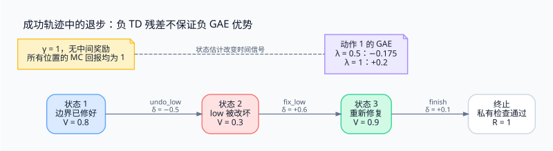

> 终局成功不能证明每一步都好。结果监督、价值基线和过程奖励给出的是不同的信息。任何更细粒度的信号，都要说清它从哪里来、什么时候可靠、会诱导出什么行为。

<!-- more -->

**系列导航**

1. [为什么需要 Agent RL](/machine-learning/agent-rl/why-agent-rl/)
2. [从工具调用到可训练轨迹](/machine-learning/agent-rl/trajectory/)
3. [从 PPO 到 GRPO](/machine-learning/agent-rl/policy-optimization/)
4. **长轨迹上的信用分配（本文）**
5. [GPU 训练与 CPU 环境如何协同](/machine-learning/agent-rl/training-system/)
6. [安全隔离与 Harness 解耦](/machine-learning/agent-rl/isolation/)
7. [跑通一个可验证的训练闭环](/machine-learning/agent-rl/minimal-experiment/)

---

## 1. 成功轨迹里也可能有真正的退步

> 只看终局结果的方法，会奖励成功轨迹里的每一步，包括其中真正的错误。

第二篇里的局部修复并不是坏动作。为了讨论信用分配，换一个更明确的例子：两个边界都已经修好，Agent 因为误读日志，又把正确的修改改了回去，然后再修一次，最后提交成功。

```text
早期前缀：读代码，修正 low，修正 high
动作 1：undo_low，把 low = mid + 1 改回 low = mid
动作 2：fix_low，再次恢复 low = mid + 1
动作 3：finish，私有验证通过
终局奖励：1
```

和直接提交相比，`undo_low` 引入了真实的缺陷和额外的工作。但第三篇的结果监督 GRPO 仍然会给整条成功轨迹一个正优势，所以在这个样本里，回退动作也被推着提高概率。

这并不意味着终局策略梯度无效。在大量轨迹上取期望之后，真正降低成功率的选择会和更低的回报相关，从而被抑制。难点在于：轨迹很长、反馈稀疏、样本有限，要攒够多少证据才能发现这种相关性。

## 2. 终局奖励为什么沿时间变成同一个数

> 只有终局奖励、没有折扣、中间不加任何项时，每个位置的回报都一样，时间上的分辨率就丢了。

定义从动作 $t$ 开始的回报：

$$
G_t = \sum_{k=t}^{T} \gamma^{k-t}\, r_k
$$

如果只有最后一步的奖励是 1、中间奖励都是 0，并且 $\gamma = 1$，那么：

$$
G_1 = G_2 = \cdots = G_T = 1
$$

三个条件缺一不可。只要引入折扣、工具成本、过程分数，或者把 KL 惩罚放进每一步的奖励，各个位置的回报就不再相同。

结果监督 GRPO 的优势只取决于整条轨迹的奖励和同组统计量，所以同一条轨迹里的所有生成位置共享同一个数。它能在轨迹之间做比较，却没有一个状态基线去单独评价「刚才那一步有没有让局面变坏」。



## 3. 价值函数补上的是对未来的估计

> critic 让不同位置的优势有了差别，但在 0/1 奖励下，成功轨迹里的优势仍然不会变成负数。

价值函数估计的是：从当前信息出发，继续按某个策略行动，能拿到的期望回报。

$$
V^\pi(h_t) = \mathbb{E}_\pi\big[\,G_t \mid h_t\,\big], \qquad
A_t^{\text{MC}} = G_t - V(h_t)
$$

Agent 处在部分可观察的环境里，critic 的输入通常是历史或历史的某种表示，不一定看得到完整的仓库状态。给 critic 额外的环境信息也是一种设计选择，需要说清这些信息在训练时怎么获得。

即使同一条成功轨迹里每个 $G_t$ 都等于 1，不同位置的 $V(h_t)$ 不同，优势的大小也会不同。但当奖励只有 0 和 1、价值估计落在 $[0, 1]$ 里时，$1 - V(h_t)$ 不会是负数。

所以「有 critic」并不等于「成功轨迹里的坏动作一定会被惩罚」，还要看用的是哪种优势估计、估计是否可靠。

## 4. 用一个数值例子理解 TD 与 GAE

> TD 残差衡量的是单步让价值变了多少；GAE 的 λ 在相信局部估计和相信实际回报之间取一个比例。局部为负，累加之后不一定还是负。

假设在上面三个动作之前，critic 分别给出下面的估计，终止状态的价值为 0：

| 动作 | 当前价值 | 动作后价值 | 即时奖励 |
|---|---:|---:|---:|
| `undo_low` | 0.8 | 0.3 | 0 |
| `fix_low` | 0.3 | 0.9 | 0 |
| `finish` | 0.9 | 0 | 1 |

这些数字只用于演算。取 $\gamma = 1$，TD 残差为：

$$
\delta_t = r_t + \gamma V(h_{t+1}) - V(h_t)
$$

$$
\delta_1 = 0 + 0.3 - 0.8 = -0.5, \qquad
\delta_2 = 0 + 0.9 - 0.3 = 0.6, \qquad
\delta_3 = 1 + 0 - 0.9 = 0.1
$$

GAE 把后续的残差按 $\gamma\lambda$ 加权累加：

$$
A_t^{\text{GAE}} = \delta_t + \gamma\lambda\, \delta_{t+1} + (\gamma\lambda)^2\, \delta_{t+2} + \cdots
$$

对第一个动作：

$$
\begin{aligned}
\lambda = 0:&\quad A_1 = -0.5 \\
\lambda = 0.5:&\quad A_1 = -0.5 + 0.5 \times 0.6 + 0.25 \times 0.1 = -0.175 \\
\lambda = 1:&\quad A_1 = -0.5 + 0.6 + 0.1 = 0.2 = 1 - 0.8
\end{aligned}
$$

局部 TD 残差为负，最终的 GAE 不一定为负。λ 越小，越依赖局部的价值估计；λ 越大，越多地使用实际的后续回报。critic 不准时，局部信号会带来偏差；最终成功里的偶然因素，又会增大长回报估计的方差。

本文按工具调用的边界来解释 TD，而 LLM 的实现可能按 token 定义 critic 和时间步。两者之间要有明确的映射，不能把工具步骤上的优势直接复制成 token 级的公式。

## 5. 过程奖励改变的是目标本身

> 过程奖励不只是额外的信号，它改写了要优化的目标。而且「谁知道这一步错了」本身就是个难题。

另一条路线是不训练 critic，直接在中间步骤给奖励。比如规定 `undo_low` 得 $-0.2$，最后成功提交得 1，其他步骤都是 0：

$$
G_1 = -0.2 + 1 = 0.8, \qquad G_2 = G_3 = 1
$$

这样确实区分了不同位置，但回退动作的回报仍然是正的。在不带基线的 REINFORCE 里，它依然会被鼓励，只是幅度小一些。而它之前的所有动作也都承担了这项负奖励，过程分数并不会自动定位到唯一的责任动作。

更根本的问题是：谁知道 `undo_low` 错了？在这个小例子里，可以检查固定的代码模式；在大型仓库里，「这次修改是否朝正确的方向前进」本身就是难题。

能用的信号包括编译检查、类型错误的变化、经过验证的子目标，以及模型的过程评分，它们各有盲点：编译通过不代表功能正确，改了指定文件不代表修好了 bug，裁判模型也可能偏爱看起来更完整的解释。

## 6. 为什么「测试失败就扣分」会适得其反

> 惩罚失败日志，等于惩罚「去发现问题」这个行为。要惩罚的是缺陷本身，而不是它被看见。

跑测试能暴露缺陷。如果每次出现失败日志都扣分，策略就会学会少测、只跑容易通过的子集，或者还没验证就提交。训练奖励上去了，实际可靠性却可能下降。

比较两条轨迹：

```text
A：修改 → 测试失败 → 定位问题 → 再修 → 通过
B：修改 → 不测试 → 直接提交
```

如果 A 因为主动发现了问题而持续受罚，奖励就把「可观测」和「任务失败」混为一谈了。要先想清楚到底想惩罚什么：最终的缺陷、资源浪费，还是真正有害的状态变化。

在满足标准 MDP 假设等条件时，势函数塑形

$$
r'_t = r_t + \gamma\, \Phi(s_{t+1}) - \Phi(s_t)
$$

可以在合适的终止条件下保持最优策略不变，同时提供更密集的信号。在有限回合里需要处理终止状态的势函数，而构造一个有用的 $\Phi$ 仍然是核心难点。随手给一个「看起来进步了」的分数，并不具备这个性质。

## 7. 分支采样能多拿到什么信息

> 从同一个中间状态分出几条路走到底，比较的才是局部动作本身。代价是环境必须能存档和恢复。

对同一个中间状态保存快照，再尝试不同的动作并各自采样到结束，就能比较这些动作的后续回报。这比只比较整条轨迹更接近局部动作的价值。

代价是：环境必须可以恢复，随机性需要控制，每个前缀都会产生更多 rollout。浏览器会话、外部 API、后台进程和时间敏感的数据，未必能像本地仓库那样可靠地回放。

还可以把任务拆成带真实验收条件的子目标，或者先用示范数据训练出恢复行为。这些手段增加了可学习的信息；而只增大 group size，增加的主要是同一道题的完整轨迹数量，并不会凭空产生步骤级的标签。

## 8. 信用分配与样本陈旧是两个问题

> 概率比处理的是「样本来自哪个策略」，优势处理的是「这个动作值不值得强化」。增加更新次数解决不了信用分配。

异步系统可能用旧权重采到一条长轨迹，等它回来时 trainer 已经更新了好几次。概率比和裁剪处理的是行为分布和当前策略之间的差异，优势解决的是动作应该怎样更新。

精确的 token 级比率并不能自动纠正历史状态分布的偏移。部分可观察的环境、混合的策略版本、样本筛选和严重的陈旧，都需要额外考虑。增加更新次数，也不会让一个轨迹级的常数突然具备时间上的分辨率。

所以选方法之前，先问清楚缺的是什么：采样数量、可信的步骤反馈，还是对未来回报的估计。答案不同，需要的工程投入也完全不同。

## 参考资料

- [GAE](https://arxiv.org/abs/1506.02438)：TD 残差的加权累加与偏差、方差权衡。
- [DeepSeekMath](https://arxiv.org/abs/2402.03300)：结果监督与过程监督的不同优势构造。
- [Policy invariance under reward transformations](https://www.cs.utexas.edu/~pstone/Papers/Reading/NgHaradaRussell99.pdf)：势函数奖励塑形的条件与性质。
- [Concrete Problems in AI Safety](https://arxiv.org/abs/1606.06565)：奖励投机等问题的系统性讨论。

---

上一篇：[Agent RL（三）：从 PPO 到 GRPO](/machine-learning/agent-rl/policy-optimization/)

下一篇：[Agent RL（五）：GPU 训练与 CPU 环境如何协同](/machine-learning/agent-rl/training-system/)

配图源文件：[Graphviz DOT](https://github.com/Zqzqsb/Blog/blob/master/MachineLearning/AgentRL/assets/04-credit.dot)。
